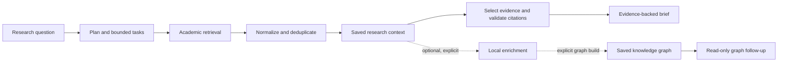

# FODS Research Agent: From Question to Evidence-Backed Brief

**Primary project deliverable: the FODS research-to-brief application.** Start with
`python -m fods.cli run`. The separate `rla` CLI remains available for the repository's earlier
research-literature pipeline; it is not an alias for FODS and does not use the FODS task runtime.

Both applications share selected research primitives from `rla`: paper models and content hashes,
configuration, source normalization and deduplication, provider clients, and caching. The FODS
runtime owns its validated task plan, dependency scheduling, registered-tool execution, run trace,
evidence selection, citation-ID validation, and brief write. The `rla` CLI runs its own pipeline,
graph, TUI, and evaluation commands. The distribution name in `pyproject.toml` remains `rla`, with
two separately registered console commands, `rla` and `fods`.

This README is the operational guide for both command families; FODS is the recommended starting
point. Design rationale lives in `docs/` and the ADRs. See the
[architecture and demo plan](docs/implementation_architecture_and_demo_plan.md) and
[demo commands](docs/demo_commands.md). For an assessment-ready walkthrough, see the
[user and assessment guide](docs/fods_assessment_demo_guide.md),
[live demo script](docs/fods_live_demo_script.md),
[setup checklist](docs/fods_demo_setup_checklist.md), and
[artifact inventory](docs/fods_demo_artifact_inventory.md).

For the teammate showcase, start with the [FODS Research Studio team handover](docs/team_handover.md).



The graph is an optional follow-up index over saved, enriched context. It is not a
dependency of ordinary `fods run`; graph build/update are explicit commands.

> **FODS entry point:** `python -m fods.cli` or the installed `fods` command. The companion
> command is `rla`; `python -m src.rla.cli` does not work with this src-layout package.

## FODS backend CLI profiles

Use `fods run --profile quick --topic "<topic>" --question "<question>" --output "<new-path>"`
for a fast answerable abstract context, or choose `--profile deep` for bounded multi-query
collection. The CLI records source timings,
candidate/context/evidence counts, snapshot identity, and citation-ID checks. Read
[research architecture and CLI acceptance](docs/research_architecture_and_cli_acceptance.md) for
limits, reuse/refresh commands, and evaluation criteria. Optional follow-on workflows are
`fods enrich` (bounded local Ollama extraction tasks) and `fods discover-references` (bounded
one-hop academic reference resolution); both leave the original abstract context unchanged.
Retrieval quality is marked `PENDING HUMAN REVIEW`; the benchmark pack and protocol are in
[`docs/retrieval_benchmark_baseline.md`](docs/retrieval_benchmark_baseline.md).

### Recommended first run

After [installation](#installation-fresh-windows-machine), run the deterministic fixture workflow:

```powershell
.\.venv\Scripts\python.exe -m fods.cli run `
  --topic "Graph Attention Networks" `
  --question "How did graph attention use local neighborhoods?" `
  --output "data/fods/briefs/mvp-final-demo.md" `
  --mode simulate --planner fixture
```

Simulation uses bundled fixture papers and a deterministic planner; it makes no academic-source
requests or model calls. Live mode retrieves from configured academic sources and requires network
access; `--planner ollama` additionally needs a running Ollama model. A Gemini final answer requires
the configured key and the explicit `RLA_FODS_ALLOW_GEMINI=1` opt-in. Every run writes a JSONL trace
under `data/fods/runs/` and a saved context under `data/fods/topics/`. The command reports its run
ID. Inspect a trace and generate its HTML replay with `python -m fods.cli replay <trace-path>`.

## Optional graph-assisted follow-up

First create or reuse a research context, then enrich it with the configured local Ollama
model and explicitly build its graph. Follow-up queries read that saved snapshot, make no model
or network calls, and never trigger a rebuild:

```powershell
python -m fods.cli run --topic "Graph Attention Networks" `
  --question "How did graph attention use local neighborhoods?" `
  --output "data/fods/briefs/gat-first.md" `
  --mode simulate --planner fixture
python -m fods.cli enrich --topic "Graph Attention Networks" `
  --model "ollama/qwen3:4b" --max-papers 15
python -m fods.cli graph build --topic "Graph Attention Networks"
python -m fods.cli graph follow-up --topic "Graph Attention Networks" `
  --question "Which papers use GAT?"
```

Other supported forms include concept discussion, topic findings, topic limitations, stored
citation links by paper ID, and concepts shared by two paper IDs. Results include paper IDs,
segment IDs, and source excerpts. Shared labels indicate vocabulary overlap only. Unsupported
questions receive examples and can fall back to `fods graph query --topic ... --method ...`.
Research contexts, enrichment artifacts, briefs/runs, graph snapshots, and graph measurements are
stored below `data/fods/`; graph snapshots are under
`data/fods/knowledge_graph/<topic-key>/graph.json`. See the [MVP completion report](docs/mvp_completion_report.md)
for verification scope and limitations.

The saved Graph Attention Networks snapshot in this checkout is an older schema: `graph stats`
can inspect it, but the current query command requires a schema-v2 graph. `graph build` refuses to
replace an existing snapshot unless `--force` is specified. Preserve the existing file before an
intentional rebuild; follow-up never rebuilds it automatically.

## FODS browser visualizer

Start the local interactive interface from the repository root:

```powershell
.\.venv\Scripts\python.exe -m fods.cli serve --host 127.0.0.1 --port 8765
```

Then open <http://127.0.0.1:8765/>. The interface provides Overview, Execution, FODS Lab,
Evidence & Answer, and Runs & Replay views. Deterministic simulation uses fixture papers and
does not call Gemini. For live runs, select live mode; provider credentials remain in the Python
process. Gemini answers require a configured key and the explicit `RLA_FODS_ALLOW_GEMINI=1`
opt-in before starting the server. Replay reads saved events without invoking models or sources.
The server binds to loopback by default and writes briefs only under `data/fods/briefs/` using a
new filename.

---

## Requirements

- Windows, PowerShell.
- Python 3.11+ (verified on 3.12).
- For the TUI: **Windows Terminal** (not legacy conhost) and the `tui` extra.
- For fully-local mode: a running Ollama server (see Ollama setup).
- For cloud stages: a Gemini API key (see Gemini setup). Without one, the pipeline
  runs in keyless degrade mode.

## Installation (fresh Windows machine)

```powershell
git clone <repo-url>
Set-Location Research_AI_Agent-fods
py -3.12 -m venv .venv
.\.venv\Scripts\Activate.ps1
.\.venv\Scripts\python.exe -m pip install -e ".[dev,tui]"
Copy-Item .env.example .env
```

Use the venv's tools for everything below (`python`, `pytest`, `ruff` from
`.venv\Scripts\`). The system Python may lack test deps and ships an older `ruff`
that reports false hits.

## Repository setup

For the companion `rla` pipeline, `data/graph/` is gitignored, so a fresh clone has **no rla
graph**. Run `rla run` or `rla build` before `rla eval` / `rla ask` (both fail with
`FileNotFoundError` / "no graph" otherwise). This is separate from the FODS graph under
`data/fods/knowledge_graph/`.

Committed data can also drift: a fresh clone's first graph build is blocked until
`rla status --prune` (observed 0 matched / 26 stale / 30 missing) — see
[Data and status operations](#data-and-status-operations).

## Environment configuration

1. Copy the template: `Copy-Item .env.example .env`
2. Fill in what your mode needs (see Supported modes). `.env` is gitignored;
   never put a real key in `.env.example`.
3. All variables use the `RLA_` prefix **except** `GEMINI_API_KEY` and
   `OPENAI_API_KEY`, which have explicit no-prefix aliases (`src/rla/config.py`).
   Paths (`.env`, `data/`) resolve relative to the repo root, not the CWD, so
   running from a subdirectory is safe.

Full variable list: [Config reference](#config-reference) and `.env.example`.

## Supported modes

Only these three configurations are supported by the code:

| Mode | Text models | Embedding model | Needs `GEMINI_API_KEY`? |
|---|---|---|---|
| Fully local | `ollama/…` in all roles | `ollama/nomic-embed-text` (768 dims) | No |
| Ollama + cloud hybrid | `ollama/…` for text | Gemini embedder | Yes (embeddings still go through Gemini) |
| FODS research demo | Qwen/Ollama for structured roles; Gemini for final answer | Ollama embedder | Yes (final answer only) |
| Cloud / fallback | Gemini (native) or second provider via LiteLLM `[router]` extra | `gemini-embedding-001` | Yes |

With a blank `GEMINI_API_KEY` and no usable `ollama/…` role, the pipeline runs in
keyless degrade mode: acquisition works, LLM stages are skipped.

## Ollama setup

```powershell
ollama serve
ollama pull qwen3:4b
ollama pull nomic-embed-text
```

```dotenv
RLA_FAST_MODEL=ollama/qwen3:4b
RLA_STRUCTURED_MODEL=ollama/qwen3:4b
RLA_ANSWER_MODEL=ollama/qwen3:4b
RLA_EMBEDDING_MODEL=ollama/nomic-embed-text
RLA_OLLAMA_URL=http://localhost:11434
RLA_LLM_DAILY_BUDGET=0
```

Notes (verified, `docs/OPERATIONS_GUIDE.md` §5):

- The native backend talks to `/api/generate` (endpoints used: `/api/generate`,
  `/api/embed`). Never route `ollama/…` models through LiteLLM's `/v1` path —
  the same schema measured ~8 s native vs ~98 s via LiteLLM. That gap is
  compatibility/prefill overhead (~4096 vs ~662 prompt tokens), **not** intrinsic
  generation speed (decode floor ~55 tok/s).
- `RLA_OLLAMA_URL` takes no `/v1` or `/api` suffix; the backend appends the path.
- `RLA_OLLAMA_THINK=false` (default): reasoning-model thinking traces stay off.
- Fully-local mode needs an `ollama/…` model in the roles (then no Gemini key is
  needed at all).

## Gemini setup

```dotenv
GEMINI_API_KEY=your-key-here
```

- Get the key from [Google AI Studio](https://aistudio.google.com/apikey). Use an
  AI Studio key, not `gcloud auth print-access-token` output (OAuth tokens return
  401; `rla doctor --llm` says so).
- Canonical answer model: `gemini/gemini-2.5-flash`. The configured model must be
  servable on your key — a 404 means retired/renamed/tier-gated, so pick a current
  model in `.env`.
- Never print or commit real keys. `rla doctor --llm` performs live (deliberately
  **uncached**) probes and spends a few requests.
- Free-tier quota is per day, per model (~20 req/day observed). `llm_rpm` pacing
  does not help; `llm_daily_budget` (default 15) is a local per-run cap.

## Embedding config

- The text model and the embedding model are different settings. Defaults:
  `RLA_EMBEDDING_MODEL=gemini-embedding-001` (GA replacement for retired
  `text-embedding-004`), or `ollama/nomic-embed-text` (768 dims) for fully-local.
- Merge thresholds belong to an embedding space (`thresholds_for()`,
  `docs/adr/0007-per-embedding-model-merge-thresholds.md`). Never reuse 0.92/0.70
  across spaces.
- A new/uncalibrated embedding space starts `UNCALIBRATED`: auto-merge is
  **disabled** (fail toward duplicates, never toward false lineage), borderline
  pairs go to the bounded LLM judge. `rla calibrate-merges` **proposes** a
  threshold; a human commits it. It installs nothing.

## Verify installation

```powershell
rla doctor            # config, sources, cache — no key needed
rla doctor --llm      # live probe of every configured model (spends requests)
rla sources           # probe each source API against a throwaway cache DB
rla events            # the 10 pipeline phases, in order
```

`rla build` / `rla report` are useful with no key at all (acquisition and gap
report are keyless).

## CLI reference

The following table documents the **companion `rla` CLI**, not the primary FODS run above.
It is registered separately from `fods` and executes the `rla` pipeline. `rla` prompts
interactively for `-t` when omitted (`build`, `run`, `tui`); `ask` takes the question as a
positional argument and prompts when omitted.

| Command | What it does | Needs a key? |
|---|---|---|
| `rla doctor [--llm]` | config, sources, cache; `--llm` probes models live (uncached) | `--llm` only |
| `rla sources [--probe "q"] [--cache/--no-cache]` | probe each source API (bypasses cache by default) | no |
| `rla stats` | corpus + graph summary tables | no |
| `rla events` | print the 10 pipeline phases in order | no |
| `rla build -t "Topic" [--jsonl] [--structured-model M] [--answer-model M]` | full pipeline **without a question**: acquisition → extract → resolve → graph (40–100 papers; traverse/answer skipped). Keyless, it stops after acquisition | degrades without a key |
| `rla run -t "Topic" [-q "Q"] [--jsonl] [--structured-model M] [--answer-model M]` | full pipeline, streaming events | degrades without a key |
| `rla ask "Q" [--markdown] [--jsonl]` | answer from the built graph; no re-acquisition | yes, for the answer |
| `rla report [--jsonl]` | per-paper limitations + synthesized gaps; costs no LLM calls. Markdown is the default output (`--markdown` defaults true; there is no `--no-markdown`); `--jsonl` emits the whole report as one JSON document | no |
| `rla status [--prune]` | corpus/store/graph agreement; `--prune` deletes stale+superseded | no |
| `rla calibrate-merges` | propose (not install) a merge threshold for the embedding model | yes (embeddings) |
| `rla eval` | evaluation report → `data/eval/report.md` + `results.json` | no |
| `rla tui -t "Topic" [-q "Q"] [--structured-model M] [--answer-model M]` | live terminal UI over the same event stream as `run` | degrades without a key |

Examples:

```powershell
rla sources
rla build -t "Graph-based agent architectures"
rla run -t "Graph-based agent architectures" -q "How did GAT evolve?"
rla run -t "Graph Attention Networks" -q "How did GAT evolve?" --jsonl
rla ask "How did GAT evolve?" --markdown
rla report --jsonl
rla status
rla status --prune
rla eval
```

## TUI guide

Verified against `src/rla/tui/app.py` (`BINDINGS`, `HELP_TEXT`).

```powershell
rla tui -t "Graph Attention Networks" -q "How did GAT evolve?"
```

Requires the `tui` extra and **Windows Terminal** (not conhost). 80×24 works.
The TUI subscribes to the same event stream as `rla run`, so it cannot drift
from headless output. Rule of thumb: debug with `rla run`, demo with `rla tui`.

Panels: status (phase + clock) · counters · routing
(configured/override/resolved) · selector (session only) · log (wraps, no deltas)
· tree · answer (deltas + citations).

| Key | Action |
|---|---|
| `q` | quit |
| `c` | clear log |
| `m` | toggle model selector |
| `e` | cycle structured-role model |
| `a` | cycle answer-role model |
| `x` | clear session overrides |
| `?` | this help overlay |

The model selector offers the two role models plus configured fallbacks
(de-duplicated); cycling sets a transient session override (see next section),
never writes `.env`. Fallback traffic is visible in the UI when the router side
is connected.

## Model selection, routing, fallback

- **Model identity.** Canonical form is `provider/model`. `ollama/qwen3:4b` is
  valid; `gemini/gemini-2.5-flash` is canonical. A bare `qwen3:4b` raises
  `ModelResolutionError` (ambiguous); `foo/bar` raises it (unknown provider).
  Resolution happens before any network request, never a silent guess. Details:
  `docs/OPERATIONS_GUIDE.md` §3.4.
- **Precedence** (highest first): session override (TUI selector or
  `--structured-model` / `--answer-model` flags) > explicit `model=` call-site
  argument > stage role (`answer` → `RLA_ANSWER_MODEL` → `RLA_STRONG_MODEL`;
  structured stages → `RLA_STRUCTURED_MODEL` → `RLA_FAST_MODEL`; other stages →
  `RLA_FAST_MODEL`) > nothing (no heuristics, no load balancing).
- **Fallback** is error-category-driven and distinct from retry: it fires on
  `timeout`, per-minute 429, 5xx, network errors. It does **not** fire on bad
  credentials, malformed config, unsupported schema, or programming errors.
  Daily-quota exhaustion raises rather than failing over unless
  `RLA_FALLBACK_ON_QUOTA=true`. Streaming never falls back mid-stream.
- **Capability gate.** A model is used for a structured stage only if it supports
  schema-constrained output; otherwise the router refuses it rather than
  degrading to unvalidated JSON. Native `ollama/…` grammar-constrains via
  `format:` and needs no declaration. See `docs/OPERATIONS_GUIDE.md` §3.5.
- Multi-backend dispatch: `docs/adr/0006-multi-provider-dispatch.md`.

## Data and status operations

Files each phase writes: `docs/OPERATIONS_GUIDE.md` §1 (corpus, extractions,
concepts, graph, cache, eval outputs).

`rla status` reports per-entry agreement between the corpus, the extraction
store, and the graph:

| State | Meaning | Effect |
|---|---|---|
| matched | entry describes a corpus paper | ok |
| missing | corpus paper has no extraction | warning; graph will be partial |
| stale / superseded | extraction no longer matches the corpus | **blocks** graph builds; prune then re-run |
| graph missing/stale papers | graph disagrees with the corpus | rebuild via `rla run` |

```powershell
rla status            # read-only, no network, no model, no budget
rla status --prune    # delete stale + superseded entries, then re-run `rla run`
rla stats             # corpus + graph summary tables
```

## Common errors

**Python / venv.**

| Symptom | Cause / fix |
|---|---|
| `ModuleNotFoundError: No module named 'rla'` | `python -m src.rla.cli` never works (src-layout). Use the `rla` command. |
| `test_p1_acquisition.py` fails to collect | system Python lacks `respx`. Use `.venv\Scripts\python.exe`. |
| `ruff` reports `UP038` hits | system ruff is 0.1.14. Use the venv's pinned `ruff>=0.5`. |

**Ollama.**

| Symptom | Cause / fix |
|---|---|
| connection refused | `ollama serve` is not running; check `RLA_OLLAMA_URL` (no `/v1`/`/api` suffix). |
| structured stages refuse the model | over the LiteLLM `/v1` path the capability gate refuses local models; use native `ollama/…` ids instead. |
| slow extraction (~90 s+/paper) | `ollama/…` routed through LiteLLM `/v1`; switch to native `ollama/…` (`/api/generate`). |
| everything becomes duplicates | new embedding space is `UNCALIBRATED`; run `rla calibrate-merges` and commit a threshold. |

**Gemini (incl. 404).**

| Symptom | Cause / fix |
|---|---|
| 404 / `NOT_FOUND` | configured model retired/renamed/tier-gated — pick a current model in `.env`. `rla doctor --llm` hint: "model retired". |
| 401 on every call | OAuth token instead of an AI Studio key. Replace `GEMINI_API_KEY`. |
| `limit: 0` / `RESOURCE_EXHAUSTED` on Pro models | free tier has no quota there; use a flash-tier model. |
| daily per-model allowance spent | per day, per model (~20 req/day). Use a model with quota left or wait; `RLA_FALLBACK_ON_QUOTA=true` opts into spending the reserve. |

**Model resolution** (exact messages, `src/rla/errors.py` + `src/rla/config.py`):

```text
Ambiguous model id 'qwen3:4b': it names no known provider. Specify an explicit
provider prefix, for example 'ollama/qwen3:4b' (or another supported provider/model id).
```

```text
Unknown provider prefix 'foo' in model id 'foo/bar'. Known providers: anthropic,
azure, bedrock, cohere, deepseek, gemini, groq, mistral, ollama, openai, openrouter, xai.
```

Fix: write the id as `provider/model`. These raise before any request; the router
never retries or falls back on them.

**Embeddings.** Never reuse 0.92/0.70 across embedding spaces. Uncalibrated space
→ auto-merge disabled (safe direction: visible duplicates, never fused lineage).

**Fallback.** Not firing on quota/auth/400s is by design (see previous section).
A failure that "should have failed over" is usually a non-fallback-eligible
category — check the category, not the retry count.

**Integrity.** `rla ask` "no graph" / `rla eval` `FileNotFoundError` → fresh clone
(no `data/graph/`); run `rla run` first. `rla status` red rows → prune + re-run.

**TUI.** Garbled layout → legacy conhost; use Windows Terminal. `the TUI needs
Textual` → `pip install -e ".[tui]"`.

**Diagnosis workflow:** `rla doctor` → `rla doctor --llm` → `rla sources` →
`rla status` → `rla run --jsonl` (inspect per-phase events) → narrow with the
table above.

## Troubleshooting decision flow

```text
rla doctor fails ─▶ venv installed? (.venv\Scripts\python.exe) ─▶ .env present?
rla doctor --llm fails ─▶ 401? bad key ─▶ 404? retired model ─▶ quota? daily cap
sources empty ─▶ rla sources: which index is down? (bot protection / rate limit)
status red ─▶ stale/superseded? --prune + re-run ─▶ missing? re-run extracts them
run stalls at extraction ─▶ quota spent (free tier ~20/day) or hung provider (120 s timeout)
ask/eval "no graph" ─▶ rla run first (data/graph/ is gitignored)
TUI broken ─▶ conhost? use Windows Terminal ─▶ Textual missing? install [tui]
slow local inference ─▶ ollama/… via LiteLLM? switch to native ollama/… ids
false lineage ─▶ over-merge; check embedding-space calibration (ADR-0007)
```

## Useful commands

```powershell
rla doctor --llm
rla sources --probe "graph attention networks"
rla build -t "Graph Attention Networks" --jsonl
rla run -t "Graph Attention Networks" -q "How did GAT evolve?" --jsonl
rla ask "How did GAT evolve?" --markdown
rla report
rla status
rla stats
rla events
rla calibrate-merges
rla eval
rla tui -t "Graph Attention Networks" -q "How did GAT evolve?"
```

## Config reference

`.env.example` is the documented contract — every variable is described there.
Key settings (defaults in `src/rla/config.py`):

| Variable | Default | Notes |
|---|---|---|
| `GEMINI_API_KEY` | (blank → degrade mode) | no `RLA_` prefix; AI Studio key |
| `OPENAI_API_KEY` | (blank) | no `RLA_` prefix; optional second-provider credential |
| `RLA_FAST_MODEL` | `gemini-2.5-flash-lite` | generic fallback; `doctor --llm` reaches it via the structured role (empty `RLA_STRUCTURED_MODEL`) |
| `RLA_STRONG_MODEL` | `gemini-2.5-flash` | fallback for answer role |
| `RLA_STRUCTURED_MODEL` | (empty → `fast_model`) | 4 schema-constrained stages |
| `RLA_ANSWER_MODEL` | (empty → `strong_model`) | streamed answers |
| `RLA_EMBEDDING_MODEL` | `gemini-embedding-001` | or `ollama/nomic-embed-text` |
| `RLA_FALLBACK_MODELS` | `gemini-2.5-flash` | ordered, comma-separated |
| `RLA_FALLBACK_ON_QUOTA` | `false` | opt into failover on daily quota |
| `RLA_LLM_PROVIDER` | `gemini` | `gemini` \| `litellm` (needs `[router]` extra) \| `ollama` |
| `RLA_LLM_BASE_URLS` | (empty) | JSON map `{"provider": "url"}`; LiteLLM path only |
| `RLA_STRUCTURED_OUTPUT_MODELS` | (empty) | operator assertion for LiteLLM-route local models |
| `RLA_OLLAMA_URL` | `http://localhost:11434` | no `/v1`/`/api` suffix |
| `RLA_OLLAMA_THINK` | `false` | reasoning-trace emission |
| `RLA_LLM_RPM` / `RLA_LLM_MAX_RETRIES` | `15` / `5` | pacing is not the quota fix |
| `RLA_LLM_DAILY_BUDGET` | `15` (`0` = uncapped) | local per-run, per-model cap |
| `RLA_LLM_TIMEOUT_SECONDS` | `120` | per provider attempt |
| `RLA_SERPAPI_API_KEY` | (blank → Scholar pass off) | recent-preprint coverage |
| `RLA_TARGET_CORPUS_MIN` / `_MAX` | `40` / `100` | corpus bounds |

## Development and testing

```powershell
python -m pytest tests/ -q                          # 668 passed
python -m pytest tests/test_p8_gap_validity.py -v    # one module
python -m ruff check src/                            # line-length 100, select E,F,I,UP,B
```

`pyproject.toml` sets `asyncio_mode = "auto"` — no `@pytest.mark.asyncio`
markers. Test modules are named `test_p<N>_*.py` after the `PLAN.md` milestone
they gate. Tests redirect all paths to `tmp_path` and never touch `data/`.

## Documentation map

| Document | Covers |
|---|---|
| `docs/OPERATIONS_GUIDE.md` | full operations reference this README summarizes |
| `docs/adr/0006-multi-provider-dispatch.md` | MultiBackend dispatch design |
| `docs/adr/0007-per-embedding-model-merge-thresholds.md` | per-embedding-space merge thresholds |
| `docs/adr/` | all architecture decisions behind the LLM layer |
| `docs/demo_commands.md` | command-by-command manual checks with expected output |
| `docs/fods_assessment_demo_guide.md` | current application, architecture, modes, and limitations |
| `docs/fods_live_demo_script.md` | presenter-ready 8–10 minute walkthrough |
| `docs/fods_demo_setup_checklist.md` | environment, rehearsal, and fallback checks |
| `docs/fods_demo_artifact_inventory.md` | artifacts, provenance, availability, and graph demo |
| `docs/checkpoints/2026-11-01/PROJECT_STATE.md` | authoritative implementation and evidence checkpoint |
| `docs/checkpoints/2026-11-01/NEXT_PHASE_PLAN.md` | gated benchmark/frontend milestones and acceptance criteria |
| `docs/checkpoints/2026-11-01/SESSION_HANDOFF.md` | next-session starting point and immediate task |
| `docs/env_loading.md` | how `.env` is found and resolved |
| `PLAN.md` | milestones and acceptance gates |
| `AGENTS.md` | conventions and gotchas for coding agents |

## License

See repository history. `research-literature-agent-project-final.md` is the
read-only original specification.
