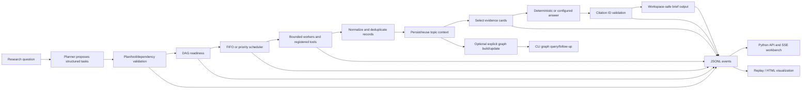

# FODS Research Agent — Project State Checkpoint

**Checkpoint date:** 2026-11-01  
**Repository:** `D:\Research_AI_Agent-fods`  
**Checkpoint type:** implementation checkpoint plus same-day Research Studio continuation  
**Authority:** sections below retain the initial inspected state; the continuation update records later changes in this checkout. Current source, tests and dated verification take precedence over earlier status prose.

## Continuation update — production frontend implementation

After the initial checkpoint, the owner approved the Research Studio production implementation. The active page now uses Research, Trace, FODS Lab and Library routes, with `/?legacy=1` retaining the classic workbench. Live runs reject fixture planning, source-cache bypass is forwarded to the CLI executor, and saved-context selection is bound to its immutable hash. The browser shows provider configuration without claiming reachability, actual event filters/details, recorded question/evidence links, honest queue state, active tasks without invented worker IDs, and cursor-specific per-task stack state. Pinned local `d3-path` 3.1.0 and `d3-shape` 3.2.0 provide DAG edge geometry while the browser code owns SVG rendering.

Focused production web/frontend/runtime/visualization tests passed **43 passed, 1 skipped** before the D3 integration; D3 asset serving and geometry tests are being included in the final verification. Live browser acceptance remains blocked because Ollama is unreachable and local browser use is disabled by Work settings. Gemini FODS opt-in was off. See [`IMPLEMENTATION_BASELINE.md`](IMPLEMENTATION_BASELINE.md), [`fods_frontend_acceptance_report.md`](../../fods_frontend_acceptance_report.md), and [`fods_screenshot_inventory.md`](../../fods_screenshot_inventory.md) for the current gates. No original research or graph snapshot was used for this work.

## Owner decision revision — frontend work authorized

The project owner explicitly waived the human-review benchmark as a prerequisite for beginning frontend development. This supersedes the earlier sequencing statements below that say Phases 3–6 must wait for Phase 1. The benchmark remains **unreviewed and not passed**; its blank paired (650-row) and pooled (450-row) files are preserved, and no retrieval-quality claim is made. Continue preserving the benchmark materials and complete human review later if it remains a project goal.

Frontend work is authorized using clearly marked synthetic/demo fixtures. The accepted backend baseline, original research/enrichment artifacts, graph snapshot, and classic workbench fallback remain protected. This continuation adds an initial Chat / Trace / FODS Visualizer shell in the existing web application; it remains in progress until the automated integration and browser evidence gates are completed. The Windows loopback restriction still prevents claiming a real browser walkthrough or screenshot.

## Earlier redesign gate — superseded by current owner approval

At the time of this checkpoint, the owner requested design deliverables and a static prototype before production changes. That instruction is retained here as history. The newer owner brief dated 2026-11-01 explicitly approved production implementation of the Research Studio in the existing application, including real runtime integration, D3/SVG visualizations, and a production browser verification. That newer instruction supersedes the design-only restriction. The human retrieval benchmark remains pending and unpassed; the waiver remains a sequencing decision, not an evaluation result.

Production implementation is in progress. Preserve the classic `/?legacy=1` route and all pre-existing work. Do not call synthetic fixtures live research. The D3 package integration and full live-provider run remain unverified until the environment gates described in the implementation baseline are resolved.

## A. Project identity and objectives

FODS Research Agent is an educational research-to-brief application for a Fundamentals of Data Structures course. It accepts a bounded literature question, gathers paper records, persists reusable context, selects evidence, checks citation IDs, and saves a brief. It addresses the opacity of agent workflows: a plan, execution order, readiness decisions, retries/failures, task state, evidence, and output should be inspectable.

The data structures are part of the execution system. The task dependency DAG gates readiness; FIFO and priority queues select ready work; a task-ID map stores runtime state; per-task stacks record nested execution; event logs preserve decisions for inspection and replay. These structures are used to govern work, not just explained after the fact.

The project boundary is an educational, bounded agent rather than a general autonomous system. The guiding principle is **“The LLM suggests; the FODS runtime governs.”** A planner may propose tasks, but validated runtime code controls dispatch, tool access, retries, citations, and file writes.

## B. Repository and architecture snapshot

### Repository state inspected

- Branch: `codex/fods-mvp-acceptance`
- HEAD: `f533ae1ea8b0af7bdf99a6fee0d9f44d3b267ed8` (`Fix cross-platform FODS output path validation`)
- `origin/codex/fods-mvp-acceptance` points at the same commit.
- Recent branch history: `f533ae1` path validation fix; `ded2adf` CI acceptance preparation; `48b5962` Phase 2 research runtime. `main` is at `9152a05`; it is not the checked-out branch.
- Initial working-tree status before this checkpoint: modified `README.md`, `docs/demo_commands.md`, and `docs/mvp_completion_report.md`; untracked four demo guides; untracked `.pytest-tmp/`. These are pre-existing session work and were preserved. The checkpoint files created now are additional untracked documentation. No commit or push was made.
- The untracked `.pytest-tmp/` contains prior isolated graph demonstration data and a replayed **copy** of a saved trace. It is not the original research context or published graph.

### Main packages and entry points

- `src/fods/`: primary FODS application. Main modules: `cli.py`, `models.py`, `plan.py`, `planner.py`, `runtime.py`, `events.py`, `tracing.py`, `research.py`, `sources.py`, `tools.py`, `safety.py`, `visualize.py`, `webapp.py`, `benchmark.py`, `knowledge_graph.py`, and `graph_followup.py`; `web/` contains static HTML, JavaScript, and CSS.
- `src/rla/`: companion research-literature pipeline and shared primitives. It owns its own pipeline, source/model/configuration abstractions, graph/evaluation/TUI functions; it is not an alias for the FODS runtime.
- `pyproject.toml` registers `fods = fods.cli:app` and `rla = rla.cli:app`. The supported FODS module entry point is `python -m fods.cli`.
- FODS CLI commands inspected in source include `run`, `enrich`, `discover-references`, `replay`, `serve`, and `graph build/update/query/stats/follow-up`, plus preflight.

### Execution/data flow



### Responsibilities and boundaries

- **Sources/retrieval:** `fods.sources` and `fods.research` execute bounded academic-source tasks, normalize and deduplicate returned records, and preserve provenance. The benchmark collection report records Semantic Scholar, OpenAlex, arXiv, Crossref, and DBLP as used sources. Live retrieval depends on network and source/provider availability.
- **Planner/runtime:** `fods.planner` produces or loads a structured `TaskPlan`; `fods.plan` validates dependencies and cycles; `fods.runtime.run_plan` owns readiness, scheduling, bounded concurrency/retries, task state, event emission, and completion.
- **Context/evidence/answer:** `fods.tools` persists/reuses topic contexts, retrieves evidence, drafts an answer using the configured deterministic or model route, validates citation IDs against selected evidence, and writes a brief only through the safe output path.
- **Events/persistence:** `fods.events.EventLog` emits ordered events to a JSONL file and/or sink. CLI and web flows use this runtime event source. `fods.visualize` renders an HTML view from recorded events.
- **Browser/API:** `fods.webapp` uses Python `ThreadingHTTPServer`; it serves static HTML/JS/CSS, JSON APIs, and Server-Sent Events (`text/event-stream`). The browser submits a run via `POST /api/runs`, listens via `EventSource` to `/api/runs/{id}/events`, and can request history, contexts, brief, visualization, replay, cancellation, and run status. Browser code renders events; it does not schedule tasks.
- **Optional graph:** explicit graph build/update indexes saved enrichment artifacts and context; query/stats/follow-up read snapshots. Graph operations are a separate CLI workflow, not a prerequisite or hidden stage in normal `fods run`.

## C. Backend implementation status

“Tested” here means covered by source tests included in the accepted CI run, or by the cited acceptance artifact validation. It does not mean every provider combination or browser rendering was verified.

| Capability | Implementation status | Evidence / boundary |
|---|---|---|
| Structured planning and tool/plan validation | Implemented and tested | Pydantic task contracts and `validate_plan`; web/API integration test sees `plan_validated`. Fixture acceptance passed. Live planner use is provider-dependent. |
| Dependency DAG and cycle rejection | Implemented and tested | Runtime validates before dispatch; runtime tests include cycle rejected before any tool call. FODS Lab has a cycle demonstration action, not manually rehearsed in a browser here. |
| Readiness calculation | Implemented and tested | Plan levels and runtime prerequisite completion drive ready state; tests exercise dependencies/concurrency. |
| FIFO and priority heap | Implemented and tested | `deque` FIFO and `heapq` priority queue; priority ties retain insertion order. Runtime test covers priority ordering; FODS Lab comparison launches deterministic runs. |
| Bounded workers/retries | Implemented and tested | `run_plan` bounds concurrency and attempts; retries and terminal states are evented. Provider-dependent live latency is not an acceptance guarantee. |
| Task-state map | Implemented and tested | `RunResult.states` keyed by task ID and UI projection of accepted plan/events. |
| Per-task stack/recovery | Implemented and tested | `TraceStack` is per task; stack/recovery events exist and tests cover provider failure/unwind and invalid citation output block. UI only shows a summarized recent stack history. |
| Runtime events and persisted traces | Implemented and tested | Ordered `RuntimeEvent`, append-only JSONL writer, event sink, and redaction tests. Fixture CI produced a trace. |
| Academic retrieval and normalization | Implemented; demonstrated in benchmark collection | Paired 20-run report records live source acquisition. Fixture CI does not test fresh retrieval. Existing audit notes possible missed preprint/published identity merges. |
| Context persistence and reuse | Implemented and tested | Context-ready and reuse paths exist; runtime tests cover a saved-context follow-up. |
| Evidence selection | Implemented and tested | Selected cards map citations to papers; token budget and paper mapping have tests. CI artifact contains four selected cards. |
| Answer generation | Implemented; fixture acceptance verified | Fixture route is deterministic. Live LLM answer route requires configuration/opt-in and was not established by fixture CI. |
| Citation-ID validation | Implemented and tested | Validates citation-marker membership/mapping to selected evidence and blocks invalid writes. It does **not** establish semantic entailment. |
| Workspace-safe output | Implemented and tested | Cross-platform and traversal path tests are in runtime/web tests; branch commit fixed Windows path validation; CI passed. |
| Replay | Implemented and tested | CLI HTML replay, RunManager replay, and event-only replay test; replay performs no fresh tool calls. Local replay of a copy generated HTML. |
| Optional knowledge graph | Implemented and tested for graph stage | P4 graph tests passed in CI; isolated schema-v2 graph was queried through production CLI. Original published graph was not migrated. |

## D. Backend acceptance evidence

The accepted backend baseline is branch `codex/fods-mvp-acceptance`, commit `f533ae1`, workflow [41296050154](https://github.com/kushalk-hub/Research_AI_Agent/actions/runs/41296050154).

- Full suite: **797 passed**.
- P4 graph-stage tests: **28 passed**.
- Ruff and `compileall`: passed.
- Deterministic fixture run: `a358ed9efa63`; **8/8 tasks** completed, zero failed task attempts, four context papers, four selected evidence cards, citation IDs **P1/P2/P3** accepted by the validator.
- Brief, JSONL trace, and HTML visualization were uploaded as the `fods-mvp-acceptance` Actions artifact. They are not in this checkout because `data/fods/` is ignored.

This proves the accepted backend/runtime and artifact-validation scope. It is **not** evidence of live retrieval relevance, live provider success, or semantic citation correctness.

## E. Frontend: implementation versus design

The actual static interface in `src/fods/web/index.html` has five tabs: **Overview**, **Execution**, **FODS Lab**, **Evidence & answer**, and **Runs & replay**. `app.js` maintains a selected run in page state, starts runs through the Python API, receives SSE via `EventSource`, renders a clickable task DAG and inspector, task timeline, queue/state/stack panels, evidence and citations, history and replay. The server exposes the corresponding API endpoints. No separate JavaScript runtime scheduler is authoritative.

The design reference [`docs/design/frontend_design_research.md`](../../design/frontend_design_research.md) is a proposal for **Chat**, **Trace**, **FODS Visualizer**, persistent run/session navigation, a citation/evidence drawer, and synchronized projections. Those are not the shipped product shell. Backend acceptance is now complete, but human-reviewed retrieval evaluation is not, so the design document's remaining benchmark prerequisite still blocks redesign.

| Proposed capability | Status | What code/evidence supports that status |
|---|---|---|
| 1. Research chat and multi-turn follow-up | Proposed only | Current Overview is a run form; no conversation/message model or chat transcript. A new run can reuse context, but is not a chat turn. |
| 2. Reusable session/context management | Partially implemented | Saved topic-context list/reuse, run history, and snapshots exist. No persistent session/sidebar or multi-run conversation object. |
| 3. Task and execution trace | Implemented | Execution tab shows a task DAG, timeline, event table, and inspector; API integration tests exercise run/event flow. |
| 4. Correlated model/tool/source waterfall | Partially implemented | Chronological events, task timing, source activity, and model attribution exist. No complete correlated multi-lane waterfall with stable parent/child activity contracts. |
| 5. Interactive dependency DAG | Partially implemented | SVG DAG is generated from accepted plan and states; clicking a task updates inspector. No event-step-synchronized visualization cursor. |
| 6. Queue ordering and scheduler decisions | Implemented | Queue events and policy are rendered; FIFO-vs-priority comparison runs identical deterministic scenarios and displays dequeue order. |
| 7. Worker-slot visualization | Not implemented | Concurrency is configurable and task intervals exist; no occupied worker-slot lane/panel. |
| 8. Task-state map | Implemented | FODS Lab shows state/attempt/result summaries keyed by task ID from plan/events. |
| 9. Per-task stack and recovery visualization | Partially implemented | Stack push/pop and recovery decisions render as a recent list; no full per-task synchronized stack/recovery timeline. |
| 10. Event stepping, playback, and reset | Partially implemented | Replay emits recorded events with a delay/speed control. No pause, forward/backward single-step, cursor, or reset controls. |
| 11. FIFO versus priority comparison | Implemented | FODS Lab starts two deterministic runs and compares actual runtime dequeue events. Browser interaction has not been manually rehearsed here. |
| 12. Evidence inspection and citation-to-paper navigation | Implemented | Evidence cards and answer citations are shown; clicking a citation switches to Evidence and highlights/scrolls to its card. This is not a side drawer. |
| 13. LIVE/SIMULATION/REPLAY provenance | Implemented but not verified in browser | API/run records and UI code label live, simulated, and replay runs and show actual traced model calls. No browser end-to-end check in this environment. |
| 14. Run history and replay | Implemented but not verified in browser | History/replay APIs and UI code exist; RunManager replay is tested. Full browser workflow is not verified. |

### Current documentation discrepancies

- The README development section and older `AGENTS.md` text cite a **668 passed** historical test baseline; the later accepted CI record on this branch reports **797 passed**. Use the dated CI acceptance record for this branch.
- `docs/retrieval_benchmark_baseline.md` says the 20-run collection remains pending operator budget review, while `docs/paired_retrieval_benchmark_collection.md` reports 10/10 pairs collected and the audit inspects all 20 logs. Actual paired and pooled review files exist; human labels are still blank. The collection status is complete; quality review is pending.
- The design research event-to-UI map describes many event projections as “Available,” but implementation is mixed: for example, task/event inspection is present while worker slots and event stepping/backward/reset are absent, and the full correlated waterfall is not present. The capability table above reflects inspected source and test scope.
- `docs/master.md` is a project/specification narrative with future-tense language; it is not evidence that its entire intended product is shipped.

## F. Frontend verification status

| Check | Status at checkpoint |
|---|---|
| Browser server starts | **Yes, process startup was previously observed** for `python -m fods.cli serve --host 127.0.0.1 --port 18765`. |
| Browser can connect to local server | **No, not in the recorded Windows session.** Browser access timed out; a PowerShell HTTP request returned Windows `WSAEACCES`. No security settings were changed. |
| Browser UI submits a run | **Not manually verified.** The automated `tests/test_fods_webapp.py::test_http_submission_streams_real_simulated_runtime_and_saves_only_validated_brief` posts an actual simulated run to the HTTP API. |
| SSE runtime events are delivered | **API tested in CI; browser rendering not manually verified.** The web integration test consumes the SSE endpoint and asserts plan, queue, tool, evidence, citation, and brief events. |
| Evidence and brief appear correctly in the browser | **Not manually verified.** API/source and fixture artifact prove evidence/brief generation; no browser session confirmed visual rendering. |
| Replay through browser UI | **Implemented in source; not manually verified.** RunManager replay is covered by a test; a local copied-trace CLI replay generated HTML. |
| FODS Lab browser interactions | **Implemented in source; not manually verified.** The four controls are wired in frontend code; no interactive browser run was completed. |
| Full end-to-end interactive demo | **Not completed in this environment.** |
| Real screenshots | **None found or captured.** A repository scan found no image assets/screenshots. Do not present static HTML/mockups as screenshots. |

The prior loopback restriction is an environment risk, not a reason to alter firewall, antivirus, or security policy. The automated HTTP/SSE integration test passing in CI does not prove a human-operated browser rendered the flow correctly.

## G. Retrieval benchmark and acceptance gates

### Files and verified state

- Fixed query set: `benchmarks/retrieval_queries.json` (10 Graph Attention Networks queries).
- Paired human-review sheet: `benchmarks/paired_review_20261031.csv` — **650 candidate rows** (200 Quick, 450 Deep), all 650 `reviewer_label` cells blank. It represents query/profile/rank rows; 200 Quick observations occur in Deep as well.
- Pooled unique query/paper sheet: `benchmarks/pooled_review_20261031.csv` — **450 rows**, 45/query, all 450 `reviewer_label` cells blank. It records `quick_rank`, `deep_rank`, and membership flags; 200 rows have both ranks, per the integrity audit.
- Historical practice set: `benchmarks/historical_review_pack.csv` — 37 candidates from seven mixed live/simulated runs with unknown profile. It is not a substitute for the fixed Quick/Deep comparison.
- Collection and protocol: `benchmarks/README.md`, `docs/paired_retrieval_benchmark_collection.md`, and `docs/benchmark_integrity_audit_20261031.md`.
- Human paired scorer: `src/fods/benchmark.py`, runnable as `python -m fods.benchmark score ...`; tests: `tests/test_fods_benchmark.py`.
- Mammoth evaluator: `tools/mammoth_evaluator/` uses an OpenRouter decision client for model-assisted judgments. Those judgments are not human labels and must not be reported as such.

### Existing review and scoring procedure

The paired sheet label values are `relevant`, `not_relevant`, or `uncertain`, with optional `reviewer_notes`. Do not convert `uncertain` into a binary judgment. The `judged_pool_complete` field must be `true` for every row in a query/profile pool only when all candidate rows have binary labels. The current scorer computes Precision@K over binary-labeled rows among top-ranked candidates, Recall@K only when the full pool is binary-labeled and marked complete, plus counts/coverage/source/latency/failure and citation-validation diagnostics. It never fills labels and reports `PENDING HUMAN REVIEW` while any labels are blank.

Documented paired collection and score commands (commands are documented, not run in this checkpoint):

```powershell
python -m fods.benchmark collect --query-set benchmarks/retrieval_queries.json `
  --output benchmarks/paired_review_YYYYMMDD.csv $runLogs

python -m fods.benchmark score --input benchmarks/paired_review_YYYYMMDD.csv `
  --output benchmarks/paired_metrics_YYYYMMDD.json --k 5 10
```

For the already-collected sheet, use a **new output name** so existing data is preserved, for example `benchmarks/paired_metrics_human_YYYYMMDD.json` after annotation. The current scorer expects the paired schema (`row_type`, `profile`, `rank`, etc.); do not pass the pooled sheet to it. The pooled sheet has a different schema and no existing approved human scoring command was found. The evaluator under `tools/mammoth_evaluator` is model-assisted, not an acceptable human-score substitute.

The existing protocol specifies row labels but does **not** define reviewer identity columns, multiple-reviewer disagreement/adjudication, a pooled human-score procedure, or a quantitative pass threshold. `reviewer_notes` / pooled `notes` can hold context but do not create a structured identity field. These remain project-owner decisions; no threshold is invented here. Before the retrieval-quality gate can be called passed, approve the reviewer/identity procedure, pooled-sheet role/scoring method, and acceptance threshold, then complete actual human review and produce a reproducible report with denominators and unresolved/uncertain counts.

## H. Known limitations and risks

- Human-reviewed retrieval quality is pending; current sheets contain zero human labels.
- Citation-ID validation checks membership/mapping, not semantic entailment.
- The classic five-tab workbench remains available at `/?legacy=1`. The new default shell adds Chat, Trace, and FODS Visualizer views over the existing API/SSE run stream. Worker slots are explicitly marked as projections because runtime events do not record worker IDs; event-cursor stepping changes the displayed view only.
- Interactive Windows browser access has a loopback `WSAEACCES`/timeout risk; browser screenshots and manual end-to-end verification are absent.
- Fixture runs demonstrate deterministic runtime behavior, not live research retrieval. Replay renders stored events and is not fresh execution.
- The original normal data-root graph at `data/fods/knowledge_graph/887437c0b2403e8b/graph.json` is schema v1 (32 paper records, per direct inspection). The isolated `.pytest-tmp/mvp-existing-context-demo-99861ac9/.../graph.json` is schema v2 with 29 eligible papers, 605 nodes, and 607 edges. They are separate; do not replace or conflate them.
- Benchmark integrity audit noted that strong-ID/title-year dedup produced zero merges within the 20 runs; possible preprint/published variants or cross-source identity gaps were not investigated.
- Live retrieval and live Ollama/Gemini use depend on providers, network, credentials, quota and configuration. These paths are not proven by the deterministic acceptance run.
- No approved retrieval acceptance threshold or formal multiple-reviewer adjudication policy exists in inspected benchmark documentation.

## I. Completion statement at initial checkpoint (historical)

- **Backend/runtime acceptance:** passed for the accepted CI scope.
- **Backend implementation:** substantially implemented and tested, with provider-dependent live coverage limitations.
- **Current browser workbench:** classic workbench implemented; the new Chat/Trace/FODS Visualizer shell is in progress over existing API/SSE. Focused frontend projection tests pass; browser rendering remains unverified here.
- **Visual demonstration:** deterministic artifacts exist (remote accepted CI artifact plus local historical fixture artifacts); no screenshots or full interactive rehearsal are verified in this session.
- **Retrieval-quality evaluation:** not complete; labels and a threshold decision remain outstanding.
- **Retrieval-quality evaluation:** still pending and explicitly waived only as a frontend sequencing prerequisite; it has not been passed or replaced by synthetic data.
- **Overall project:** **not complete**. Backend acceptance is one gate, not overall product completion.

## Files inspected

Primary references include [`docs/master.md`](../../master.md), [`README.md`](../../../README.md), [`docs/demo_commands.md`](../../demo_commands.md), [`docs/mvp_completion_report.md`](../../mvp_completion_report.md), the four demo-package documents, the frontend design proposal, `src/fods/{cli,plan,planner,runtime,models,events,tools,research,sources,webapp,benchmark,knowledge_graph,graph_followup,visualize}.py`, `src/fods/web/{index.html,app.js,styles.css}`, the FODS/web/benchmark/runtime tests, benchmark sheets and documentation, and `.github/workflows/fods-mvp-acceptance.yml`.
