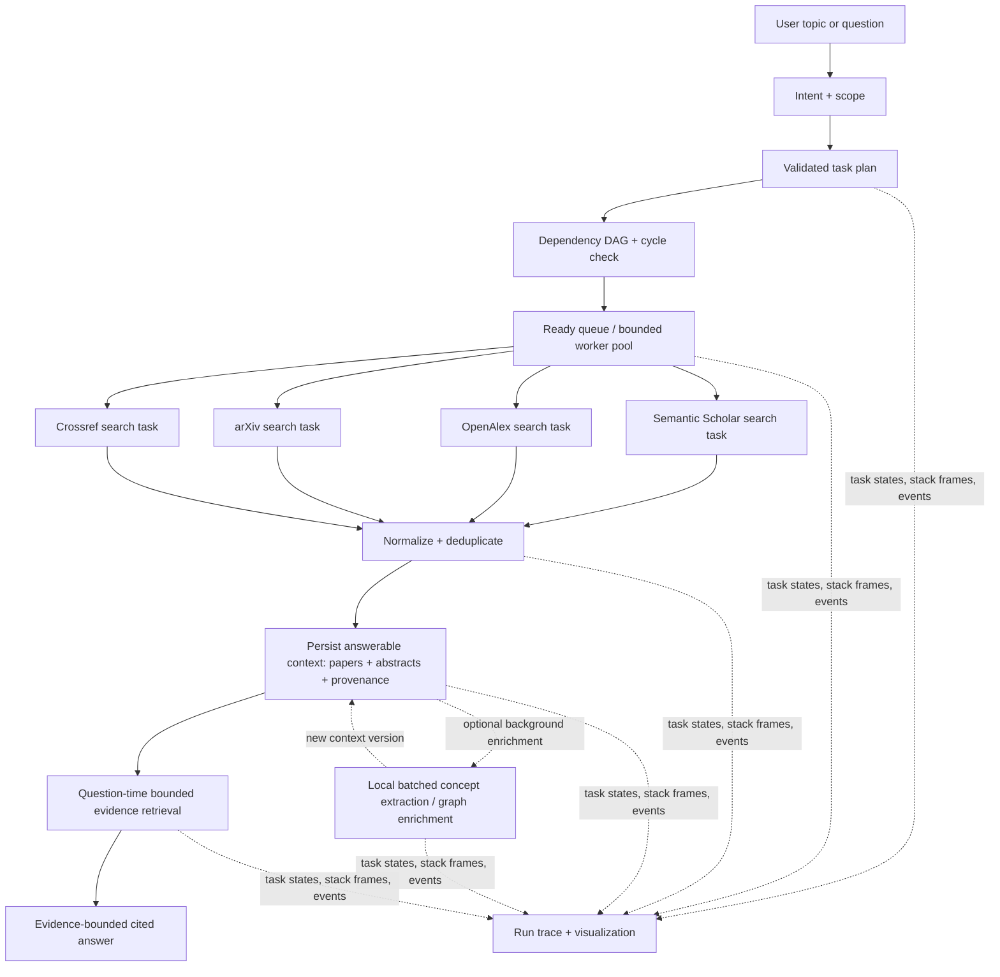

# Research Agent + FODS Runtime: Architecture and Demo Plan

**Status:** approved implementation specification (2026-10-28); `docs/master.md` is the scope authority.

**Implementation status (2026-10-28):** the first vertical slice and interactive local web
visualizer are implemented. The browser subscribes to the canonical runtime event stream through
the local Python API; it does not schedule tasks or call model/source providers. The runtime has
been exercised with a live Qwen/Ollama plan and Gemini answer, as well as deterministic source,
queue, cycle, bounded-failure, citation-failure, reuse, and replay scenarios. This fast first slice
stores paper metadata and abstracts; it does not yet perform a FODS per-paper extraction task or
build the concept graph. Live API/source behavior depends on local configuration and provider
availability; the repeatable fixture path is the guaranteed demo path.

## 1. Project goal

Build a research-paper assistant that gathers evidence from multiple academic sources, stores a reusable topic knowledge base, and answers follow-up questions with citations. Make the runtime visible enough to demonstrate FODS ideas as working parts of the system: dependency graphs, cycle detection, topological readiness, queues, task-state maps, stacks/traces, and bounded recovery.

The central rule is: **models propose meaning; the runtime controls execution.** A model can classify a request, expand a topic, extract concepts, or draft a synthesis. Deterministic code validates the plan, controls concurrency and retries, records state, selects evidence, and validates citations.

## 2. What the repository already provides

The current `rla` package is a substantial research-agent prototype, not an empty starter:

- Multi-source paper acquisition from Semantic Scholar, OpenAlex, arXiv, Crossref, DBLP, and optional SerpApi. Acquisition fans source/query work out concurrently with `asyncio.gather`.
- Deduplication, candidate scoring, citation snowballing, SQLite request caching, and resume-friendly stages.
- Structured extraction, concept resolution, paper/concept graph construction, question classification, graph traversal, and citation-checked answer generation.
- One event stream used by the CLI and Textual TUI, plus provider routing for Gemini and native Ollama text/embedding models.
- A stored corpus and graph format intended to support later questions without reacquiring papers.

Known state that affects a safe demo: limitation extraction currently has no useful live output; some concept merges and relation precision remain unverified; and the demo guide records that the committed corpus and extraction store can disagree. The demo should not claim reliable gap-analysis results from those artifacts until their agreement is checked. The current TUI already shows phase events, but it does not yet expose a FODS task DAG, ready queue, task-state table, or a nested tool-call stack as first-class panels.

## 3. Recommended fast architecture

Use two cooperating layers rather than treating them as competing projects:

1. **Research knowledge layer (`rla`)** owns reusable domain interfaces: source adapters, paper normalization/deduplication, extraction, the paper/concept graph, graph traversal, and cited answers.
2. **FODS runtime layer** owns run control: task-plan validation, dependency scheduling, task states, safe tool dispatch, concurrency limits, bounded retry/replan, and a replayable trace.

The runtime should initially call research operations through a small adapter interface. Keep the adapter surface narrow (for example, `search`, `build_topic_context`, `answer_from_context`) and keep provider/source details behind the existing modules. This lets the demo show FODS execution without rewriting the already-built research pipeline. If integration reveals the current pipeline cannot be called cleanly at these seams, extract only the required operations; do not duplicate the entire pipeline in a new package.

The main performance change is to stop making a complete per-paper LLM extraction pass a prerequisite for the first usable context. The current extraction path makes one structured model call per uncached paper, with separate resolution work. That makes context creation wait on many model generations and the slowest calls. Build an evidence-linked, answerable context first from bounded metadata and abstracts, then enrich it incrementally. The first slice uses bounded lexical evidence retrieval; concept-graph traversal belongs to a later enrichment milestone. Latency targets below are goals to measure on the presentation machine, not existing results.

### 3.1 Fast, progressive end-to-end flow

1. **Understand the request.** Identify topic, question intent (lineage, comparison, gaps, overview), freshness need, and a small initial evidence budget. Use deterministic classification first; clarify only when essential scope is missing.
2. **Create and validate a small DAG.** Example: `search 3 sources in parallel → normalize/dedupe → save answerable context → retrieve for question → draft cited answer`. Validate IDs, dependencies, and cycles before any tool call. Optional enrichment is not a prerequisite for the first answer.
3. **Search a bounded set concurrently.** The current first slice schedules 2–5 independent academic source tasks (default 3), with a two-source quorum and a bounded worker count. Expand the paper cap and query breadth only after profiling the target machine. Show per-source timing, cache status, count, and errors.
4. **Normalize and consolidate without an LLM.** Merge by DOI, then normalized title; preserve source IDs/URLs and conflicting fields. Rank deterministically by query match, recency, abstract availability, and citation metadata. Do not spend model calls scoring papers that are immediately trimmed.
5. **Persist the first answerable context.** Store focused queries, metadata, abstracts, provenance, citation links, retrieval index, build version, and timestamps. Use content hashes so unchanged records remain reusable. The first context does not wait for concept extraction.
6. **Answer from a small evidence slice.** The first slice selects evidence with bounded lexical scoring from the saved abstracts. Send only selected evidence to the configured answer model (Gemini when explicitly enabled) and validate citations against the selected cards.
7. **Enrich incrementally.** When available, batch a few papers per local structured-output call to add concept and relation cards. Validate every returned paper ID and retain evidence spans. Enrich high-value papers first and resume by content hash. Keep inferred concept edges distinct from source citation edges.
8. **Report honestly.** Show first-context time separately from enrichment completion, plus source coverage, cache hits, papers included, evidence retrieved, model calls, and retries. Save a labeled partial context if a source fails but the minimum evidence threshold is met.

### 3.2 Speed and quality policy

| Mode | Work performed | Proposed target (measure before claiming) |
|---|---|---|
| Fixture/replay | Load frozen source snapshot, build plan/index, answer from fixture | under 5 seconds |
| Warm live context | Bounded source fetch, normalize, persist abstracts/index; no per-paper LLM extraction | under 2 minutes |
| First live cited answer | Retrieve a small evidence set and synthesize locally | under 3 minutes total, including warm context |
| Concept enrichment | Batched local extraction and graph refinement | background/resumable; not on first-answer critical path |

Cold Ollama loading and academic-source latency can exceed these goals. Display cold/warm model state and stage timings rather than hiding the cause. The final report should include actual measurements on the demo machine.

Speed controls:

- In live mode, accept a usable context after a two-source quorum and cancel any outstanding optional source request; fewer than two successful sources blocks answering and writing.
- Start with 12–20 papers and a small query set; expand only when the initial evidence is weak or the user requests breadth. Make the cap configurable.
- Remove LLM relevance scoring from the critical path. Use deterministic ranking for the first cap; keep optional reranking only if evaluation shows a real quality improvement.
- Batch concept extraction to reduce prompt/model overhead, but benchmark 3–5 papers per call against one-paper calls on the actual local model before choosing a batch size. Keep batches small enough to validate outputs reliably.
- Load Ollama before the demo and limit concurrency to what the machine can serve. More concurrent requests to one local model may increase latency rather than reduce it.
- Keep Gemini out of high-volume extraction; use it for the final answer only. Leave cross-provider fallback empty so Qwen failures stay visible and do not consume Gemini quota.
- Cache source responses, extraction batches, index records, and answers separately, keyed by content/input hash and relevant prompt/schema/model version.
- Reuse topic snapshots across questions. Refresh is explicit; asking another question does not reacquire or rebuild.
- Label the initial abstract/citation context accurately. Do not claim concept graph completeness or stated limitations until enrichment/full text provides that evidence.

### 3.3 FODS structures and observable behavior

| FODS concept | Runtime responsibility | What the demo shows |
|---|---|---|
| Directed graph / DAG | Task prerequisites and fan-out/fan-in | Source tasks start independently; merge waits for all source tasks; answer waits for graph/context |
| DFS cycle detection or Kahn validation | Reject invalid dependencies before tools run | Injected cycle prints a path and confirms zero tool calls |
| Kahn readiness / topological levels | Derive tasks that may execute | Ready set changes after each completion; join task becomes ready only after its inputs |
| FIFO queue | Pick the next ready task in the baseline policy | Visible enqueue/dequeue order |
| Bounded worker pool | Run independent ready source calls concurrently | Lanes show overlapping start/end times and configured concurrency |
| Priority heap | Compare one explicit static-priority policy against FIFO | Same plan and ready set run twice; changed order is explained |
| Hash maps | Index task state/results/tools/traces by stable ID | Select a task to inspect attempts, output summary, and dependencies |
| Stack | Track nested runtime → task → tool/model frames | Push/pop on calls and returns; failed child frame unwinds to its parent |
| Append-only event log | Replay run state and feed all views | CLI/JSONL/dashboard render the same events |

Keep the teaching story focused: DAG/readiness, FIFO and priority queues, state map, and trace stack. Retrieval can use a simple bounded scan for the initial small corpus; an inverted index or separate retrieval heap is not part of the first demo.

### 3.4 Model and quota policy

- **Qwen3:4b through Ollama** proposes the task plan and performs bounded structured extraction/enrichment after the first answerable context exists. The initial cited answer does not wait for per-paper extraction.
- **Gemini** generates the final evidence-backed answer from selected evidence. Its use is explicit and visible; provider failure stops the answer, with no fallback to Ollama under a Gemini label.
- **FODS** controls orchestration decisions, task validation, scheduling, dependencies, retries, and whether the answer can be saved; the model does not govern these operations.
- **No model required for the core demo.** A deterministic planner and a small, bundled/replayable paper fixture must run the same DAG, scheduling, trace, failure, and Q&A paths. Live-source mode is an optional second run, not a dependency for showing the system.
- Treat provider errors and source errors separately. Retry only transient failures, with a fixed attempt limit; do not retry daily quota exhaustion as if it were a short outage.

## 4. First demo: outcomes and boundary

### Demo claim

“From research question to evidence-backed brief: Qwen proposes a structured plan, FODS validates and schedules independent source tasks, Qwen can enrich the stored context after it becomes answerable, Gemini synthesizes the selected evidence, and FODS saves the cited brief only after validation.”

### Must work in the first demo

1. Qwen/Ollama proposes a structured research plan with independent source tasks in live mode; fixture planning supports repeatable keyless rehearsal.
2. The FODS runtime validates tool names/arguments and dependencies, rejects cycles before tools run, and schedules each source task itself.
3. Source results are normalized, deduplicated, and persisted with metadata, abstracts, provenance, and citation links.
4. A follow-up question retrieves evidence, produces a cited answer, and validates citations against the selected evidence.
5. A write task saves the brief only after citation validation succeeds and only to an explicitly named workspace path.
6. Ask again from saved context, then compare FIFO with a fixed priority queue, reject a cyclic plan, and show bounded failure recovery.
7. Rehearse live source execution, deterministic simulated concurrency, and event replay as distinct modes. Replay demonstrates event reproducibility, not live concurrency. Keyless fixture mode guarantees the walkthrough; the current hybrid live path uses Qwen for planning and Gemini for final answer synthesis. Per-paper Qwen extraction is future enrichment, not a current behavior.
8. Force a citation absent from selected evidence; record validation failure and the recovery action, and prove the output file is not reported as successfully saved and validated.

### Keep out of the first demo

Full-text PDF download/parsing, broad autonomous research, multi-agent worker personas, unrestricted file tools, Neo4j, D3 polish, and claims that gap quality is validated. These increase integration time without improving the core FODS demonstration.

## 5. Demo implementation sequence

Sequence the work as a vertical slice, with each step producing something visible and usable:

### D0 — Freeze the demo contract

- Choose the topic and two follow-up questions.
- Define the fixture corpus and the fields required for citations.
- Define the first-answer latency target separately from background enrichment time.
- Define the run/event schema and the FODS structures the assessor must see.
- Record the current source/cache/graph state; do not modify committed corpus or extraction data as setup.

**Exit:** a reproducible walkthrough can be described without relying on a live API or secret.

### D1 — Plan and validate

- Define typed task/plan records, stable IDs, dependencies, tool names, and priority.
- Add an Ollama planner that proposes the structured plan; keep deterministic fixture planning for keyless/replay runs.
- Validate task IDs, dependencies, registered tool names, tool arguments, and output paths before execution.
- Implement structural validation, missing-dependency checks, and cycle-path reporting.

**Exit:** valid plan renders; cyclic/invalid plan is rejected before tool invocation.

### D2 — Schedule and trace

- Implement adjacency-list DAG, Kahn readiness, FIFO ready queue, task-state map, and fixed retry/step bounds.
- Add a bounded async worker pool that dispatches individual source calls. Do not wrap `Acquisition.run()` as one task because its internal fan-out bypasses FODS scheduling.
- Emit events for task ready/start/finish/failure/retry, queue changes, and stack push/pop.
- Persist events to JSONL and replay them through the same renderer.

**Exit:** fixture source tasks visibly overlap; downstream merge waits for all required sources; failure is bounded and replayable.

### D3 — Build the fast answerable context

- Use bounded parallel source calls, deterministic normalization/ranking, and an initial 12–20-paper cap.
- Persist abstracts, provenance, citations, and a lightweight retrieval index before model enrichment.
- Implement follow-up retrieval from the saved snapshot and track first-context duration.

**Exit:** a basic evidence-backed question can be answered before concept enrichment completes; repeat questions make no source calls.

### D4 — Connect research tools and guarded output

- Adapt existing `rla` source/acquisition and graph/question operations through a narrow interface.
- Batch local concept extraction and graph enrichment behind the first-answer path; resume successful batches by content hash.
- Record the selected model, provider, stage, cache status, and any fallback in events; the Qwen structured stages and Gemini answer stage must be independently verifiable.
- Make citation validation an explicit prerequisite for the report writer. If validation fails, emit the recovery decision and keep the write task blocked or failed.
- Save only to a caller-named path resolved under the approved workspace; record the destination and validation result in the trace.
- Add fixture/replay adapters that use the same interface and events without network access.
- Preserve provenance and cache behavior; make reuse of a saved topic snapshot explicit.

**Exit:** the saved snapshot gains concept/citation structure incrementally, while follow-up questions reuse it without reacquisition.

### D5 — Add the assessment view (implemented)

- Generate a self-contained offline HTML view directly from the runtime event log; it shows DAG readiness levels, task state, and measured execution lanes.
- Provide a local browser interface with Overview, Execution, FODS Lab, Evidence & Answer, and Runs & Replay views. Its Python API and SSE endpoint expose the same event records used by the CLI and offline HTML renderer.
- Keep CLI and JSONL output available for deterministic replay and debugging. The browser controls scenarios but the FODS runtime remains the only scheduler.

**Exit:** met. The same execution events drive the HTML visualization, browser views, and replay output; no UI-only scheduling logic.

### D6 — Rehearse and measure the scenarios

- Normal fan-out/merge/context/question.
- Cache/context reuse for a follow-up question.
- FIFO vs one static-priority policy on the same ready task set.
- Cycle rejected before tools.
- Simulated source failure, retry cap, and clear partial-result/termination reason.
- Citation validation failure prevents a success-marked save.
- Separately demonstrate live execution, deterministic simulation, and event replay; label which mode generated each view.
- Measure fixture, warm live context, first answer, and enrichment separately; report actual numbers and paper counts.

**Exit:** the demo runs keyless, reaches a useful context quickly, and ties each FODS claim to a visible state transition. Measured timings are reported; proposed targets are not presented as results.

## 6. Proposed build order by value

For the earliest credible demo, the implemented order is:

1. Keyless fixture + DAG validation + fan-out/merge + event replay.
2. Fast answerable topic snapshot + retrieval index + question reuse.
3. Live bounded source adapters and first-context timing.
4. Visual task graph, active-call lanes, and context-ready timer.
5. Optional local batch enrichment, priority comparison, and carefully-budgeted Gemini synthesis.

The interactive frontend and runtime/API integration now cover the first four demo views and
controlled queue/failure scenarios. Concept extraction, graph enrichment, and performance targets
remain future work; current output must be described as an abstract-backed evidence context.

This order prevents the demo from being blocked by API quotas, source outages, or model latency while ensuring the final story still reflects the intended research agent.

## 7. Architecture choices to approve before implementation

Recommended decisions for the first demo:

- Preserve the `rla` research functionality and connect it through narrow adapters; do not delete or rewrite it in the demo milestone.
- Build the FODS runtime as a separate, small module/package with an events-first interface. Avoid importing the runtime into every research stage; the runtime should own scheduling and call domain operations through adapters.
- Use deterministic fixture/replay as the guaranteed demo path, with optional live academic-source mode.
- Provide both the existing Textual CLI UI and a local browser visualizer over the shared runtime events.
- Use Qwen/Ollama for structured plan proposal and incremental extraction; use Gemini only for final answer synthesis. Keep keyless fixture planning and answering deterministic, and do not cross-fallback between these roles.
- Treat “simultaneous tool calling” as bounded concurrency of individual source tasks dispatched by the DAG runtime. Do not wrap an internally scheduled multi-source acquisition call as one FODS task.
- Use an explicitly named, workspace-confined report path, with citation validation as a hard prerequisite to saving.
- Treat live, simulated, and replay executions as distinct evidence categories in the visualization and demo narration.
- Make first answerable context the critical-path milestone; broad corpus growth and concept enrichment happen afterward or on demand.
- Use 12–20 papers as the initial target with adaptive expansion, rather than the existing 40–100-paper default for the first demo.
- Aim for measured warm-context time under 2 minutes and first cited answer under 3 minutes, subject to timing on the actual machine; show cold model load separately.

The draft `docs/superpowers/specs/2026-10-26-fods-agent-runtime-design.md` proposed a clean `fods-core` rebuild and excluded research acquisition from its first assessment. That draft is superseded for scope by this plan and `docs/master.md`: the approved target is the research-agent vertical slice, reusing narrow `rla` adapters behind a separate FODS runtime. The performance contract is progressive: bounded metadata and abstract context becomes answerable first; extraction/enrichment can continue later.

## 8. Acceptance gate

The demo is complete only when:

- Qwen/Ollama can propose a structured plan and perform bounded extraction; events identify its actual provider/model. The runtime rejects invalid tools, arguments, dependencies, or cycles before any tool runs; deterministic fixture planning remains available for keyless replay.
- Gemini serves the configured final-answer stage in a live run; its actual provider/model result is recorded, and Gemini failure cannot silently switch the final answer to Ollama.
- The runtime dispatches individual source tasks through its own DAG/readiness/queue scheduler; concurrency is demonstrated with actual live calls or deterministic simulated tool calls, and replay is labeled separately.
- Source results are normalized and saved as reusable context with abstracts, metadata, provenance, and citation links; a repeated question uses the saved context.
- The answer's citations are checked against selected evidence. An invalid citation causes a recorded recovery decision and blocks the output task; no success-marked brief is written.
- The write tool accepts only an explicitly named path that resolves inside the approved workspace.
- FIFO and fixed-priority scheduling are compared on the same ready set; cycle rejection and bounded failure recovery are shown.
- Fixture, live context, answer, and optional enrichment timings are reported separately. Proposed latency targets are not described as measured results.

The implementation order is the smallest vertical slice first: validated plan → runtime-controlled source tasks → reusable evidence context → cited answer → guarded file output. That slice, offline trace view, and interactive browser visualizer are implemented. Live-provider rehearsal has produced a Qwen-planned/Gemini-answered run; measured timings are run-specific, not general performance guarantees. The keyless cycle, scheduling, retry, citation-guard, and context-reuse cases are covered by focused checks. The current research context uses abstracts and metadata; extraction and concept graph enrichment remain future work. Do not broadly rewrite `rla`; verify each reused interface and the stored data before depending on it.
