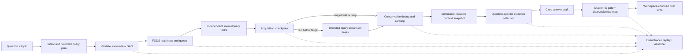

# Research Architecture and CLI Acceptance

**Status:** backend implementation baseline for the FODS research agent; frontend work is
deferred until this document's CLI acceptance gates and the human-reviewed quality benchmark are
complete.

## Goal

Reduce time to a useful, reusable research context without removing source diversity, traceable
provenance, evidence limits, citation checks, or FODS-visible control. The first answerable
context is built from academic metadata and abstracts. Full-text extraction and concept-graph
enrichment remain optional follow-on work and are not claimed by this implementation.

## Diagnosis

The critical-path problem was not simply model speed. The source task construction in the FODS
CLI replaced each task's paper limit with the number of selected sources. With the default three
sources, each source therefore searched for only three records even when its task had a larger
limit. The old live runtime also stopped optional sources after a small success quorum, kept a
small fixed retrieval slice, and did not expose a Quick/Deep policy.

The committed RLA corpus and extraction store were checked read-only before designing reuse. Their
current alignment is not safe for a FODS topic context: 30 corpus records, 26 extractions, 0
content-hash matches, 30 missing current extractions, and 26 stale extraction records. The FODS
context builder therefore treats live/fixture source output as its own context and does not claim
the committed RLA graph is a verified enrichment source.

## Runtime design



The model may classify intent or propose bounded search queries. Deterministic code validates the
schema, task graph, task limits, source quorum, candidate count, elapsed-time budget, deduplication,
ranking, evidence budget, citation IDs, and output path. The model does not own scheduling or
writing. Search tasks remain separate FODS tasks, so concurrent dispatch and their individual
timings are visible in the same event stream.

### Profiles

| Control | Quick | Deep |
|---|---:|---:|
| Target unique papers | 8 | 25 |
| Maximum retained papers | 20 | 50 |
| Candidate processing cap | 50 | 100 |
| Search sources | 3 | 5 |
| Papers requested per source/query | 10 | 15 |
| Query count | 1 | 4 |
| Minimum successful sources | 2 | 3 |
| Evidence cards | 6 | 8 |
| Evidence prompt budget | 6,000 estimated tokens | 12,000 estimated tokens |
| Acquisition budget | 120 seconds | 600 seconds |

Limits can be tightened or adjusted by CLI options within validated bounds. The evidence-token
budget uses a conservative character-to-token estimate (four characters per token); it is a
prompt-size guard, not a tokenizer measurement. Deep mode makes one initial source wave and then
at most one bounded expansion wave. It does not issue unbounded recursive searches.

### Research data and provenance

- Deduplicate first by DOI, arXiv ID, or source external ID; then by exact normalized title plus
  year when strong identifiers do not conflict. Conflicting DOI records stay separate.
- Retain per-paper source/query observations, source-native IDs, links, abstract availability,
  and transparent ranking signals. Ranking uses topic/question/query match, abstract presence,
  and new source/query coverage; citation counts do not determine relevance.
- Report raw candidates, candidates processed, truncation, duplicates merged, unique records,
  retained context records, selected evidence cards, and cited evidence IDs separately.
- Preserve source-provided reference IDs as observations. Optional one-hop reference discovery is
  now scheduled as one resolver task per seed/provider and stores provider-resolved edges separately
  from inferred concept relations.
- Persist each context as an immutable content-addressed snapshot and update a latest pointer
  atomically. Follow-up questions can reuse latest or a named snapshot; refresh is explicit.
- Source errors and stop reasons remain in the event trace and the final CLI summary. Partial
  acquisition can still answer when the profile's successful-source floor is satisfied.

### Evidence and citation contract

Retrieval ranks against the question and caps selected cards and approximate prompt size. The
answer receives only those cards. Validation blocks the brief unless at least one citation ID is
present and every cited ID maps to a selected evidence card. It also records sentence-level
citation-to-paper mappings. The mapping is an inspectable citation relationship, not an entailment
or factuality verdict; semantic support is explicitly recorded as `unverified`.

An invalid ID is a hard gate failure: the run records `citation_validation` and
`block_output_write`, leaves the write task blocked, and does not report a validated brief as
saved. Output paths must remain inside the approved workspace and match the plan's explicit path.

### Evidence modes

- **Live:** makes current provider/source calls and proves only the tasks recorded in that run.
- **Simulation:** runs deterministic fixtures through the actual FODS scheduler and proves the
  selected simulated behavior, not academic-source performance.
- **Replay:** reads prior events without calling sources or models. It proves event-log
  reproducibility, not live concurrency.

## CLI workflow

The implemented entry point is `fods run`. Use PowerShell from the repo root after activating
`.venv` (or prefix commands with `\.venv\Scripts\python.exe`).

```powershell
# Repeatable scheduler and end-to-end fixture run; no provider key required.
python -m fods.cli run `
  --topic "Graph Attention Networks" `
  --question "How do recent methods differ in neighborhood aggregation?" `
  --output "data/fods/briefs/gat-quick.md" `
  --mode simulate --planner fixture --profile quick

# Broader source acquisition with bounded query expansion.
python -m fods.cli run `
  --topic "Graph Attention Networks" `
  --question "Compare methods, evidence, and limitations" `
  --output "data/fods/briefs/gat-deep.md" `
  --mode live --planner ollama --profile deep --fresh-sources

# Reuse the latest saved topic context; no search tasks are planned.
python -m fods.cli run `
  --topic "Graph Attention Networks" `
  --question "What evidence supports the main comparison?" `
  --output "data/fods/briefs/gat-followup.md" `
  --mode live --planner ollama --context-mode reuse

# Reuse one named immutable context snapshot; replace the placeholder with a 32-hex ID
# printed as context_snapshot_id by a prior run.
python -m fods.cli run `
  --topic "Graph Attention Networks" `
  --question "Compare the approaches again" `
  --output "data/fods/briefs/gat-versioned-followup.md" `
  --mode live --planner ollama --context-mode reuse --context-id 0123456789abcdef0123456789abcdef
```

Replace the example context ID with the 32-hex `context_snapshot_id` printed by an earlier run.

Gemini remains opt-in for the final answer only. Set `RLA_FODS_ALLOW_GEMINI=1` only after the
configured key and provider mode are understood. Do not use Gemini to fan out extraction work.
Standard tests must not make live provider calls or spend quota.

## Acceptance checklist

1. CLI exposes validated Quick/Deep profiles, bounded candidate/paper/evidence/query/time controls,
   context reuse/refresh, and named snapshots.
2. Source and query jobs are independent FODS tasks in the initial wave; query expansion tasks
   depend on the runtime acquisition checkpoint and obey target, source, candidate, and time stops.
3. A regression test proves a per-query limit is not overwritten by source count.
4. Results preserve provenance and report raw, processed, truncated, unique, retained, selected,
   and cited counts without conflating them.
5. Ranking and retrieval are deterministic, inspectable, and do not rank by popularity alone.
6. Evidence prompt size respects the configured approximate budget; citation mappings resolve to
   the selected paper IDs; semantic claim support is not represented as verified.
7. Invalid citation validation blocks writing and records the recovery decision.
8. Immutable context snapshots pass checksum validation; latest and named reuse avoid reacquisition.
9. Failure, partial-success, cycle, queue-order, budget-stop, and replay paths remain testable
   without API keys.
10. No frontend application file or committed RLA corpus/extraction/concept artifact is changed by
    this backend milestone.

## Quality measurement plan

Do not claim the retrieval is more relevant from runtime counts alone. Before a quality claim,
prepare a frozen query set (at least 10 representative questions), and have a domain reviewer label
relevant papers from a pooled union of Quick and Deep results. Keep labels separate from model
judgments. Record for each query: source snapshot/date, unique candidates, reviewed relevant count,
precision@k, recall@k only where the judged pool is sufficiently complete, source diversity,
abstract coverage, citation-ID validity, and wall-clock time. Report median and p90 latency, both
profiles, failures, and query-level coverage/denominators. This benchmark is not yet human-reviewed;
there are no before/after quality numbers in this report.

## Optional enrichment and reference discovery

`fods enrich` loads one immutable context, divides abstract-bearing papers into 1–5 paper batches,
and schedules each batch as an independent FODS task. The task validates strict structured output,
paper IDs/hashes, exact abstract excerpts, and relation endpoints before caching. The only allowed
provider is Ollama; the command uses an in-memory model override with fallbacks disabled. A derived
artifact records the extraction schema, prompt version, model, source context ID, concepts,
methods, findings, limitations, and inferred concept edges. It never mutates the context used by a
prior answer. A missing local model causes the stage to fail/defer without changing the original
answerable context.

`fods discover-references` supports zero hops or a single bounded hop (default), at most 10 seeds,
two supported adapters, and 20 candidates per seed/provider. Returned records retain seed/provider
provenance and duplicate/resolved status; unresolved provider reference strings are not promoted to
verified edges. The derived snapshot has a parent context ID and becomes the new latest pointer.
Expansion is not recursive. `--source semantic_scholar|openalex` selects the preferred resolver,
and `--source-limit 1` can restrict the run to one provider. Live reference discovery uses a fresh
per-run source cache so older cached results do not masquerade as a live smoke test. Legacy topic
context files can be reused by their verified context hash; the loader rejects a requested hash
that does not match the legacy file.

Run `python -m fods.benchmark collect` on preserved Quick/Deep event logs to create blank human
annotation rows, then `python -m fods.benchmark score` after review. Collection is offline, records
run/context timestamps and model identities when present, and refuses to overwrite an existing
review pack. Uncertain labels are excluded from binary precision and withhold recall. The ten-query
paired protocol is in `benchmarks/README.md`; a full live collection can dispatch up to 230 source
requests and remains pending operator budget review. Quality remains **PENDING HUMAN REVIEW**.
The bounded Phase 2.1 OpenAlex smoke test validated reference discovery only; it is not a Quick/Deep
retrieval measurement. The Qwen enrichment smoke was blocked because the local Ollama endpoint did
not respond. Exact verification results are in `docs/phase2_verification_report.md`.

## Implementation status and remaining work

Implemented: Quick/Deep source-task flows, stop and wall-clock budgets, deduplication, ranking,
provenance, immutable context snapshots, reuse, evidence budget, citation-to-paper mapping, the
blank-label benchmark collector/scorer, and CLI entry points for bounded enrichment and reference
discovery. Fixture tests and the bounded OpenAlex smoke pass; human-reviewed retrieval evaluation
remains pending, and live Ollama enrichment remains unverified due to endpoint unavailability. The
semantic claim support field
remains `unverified`; full-text access and a calibrated claim verifier are not implemented. Exact
verification results for this checkout are recorded in `docs/phase2_verification_report.md`, not
copied from prior baseline runs.
