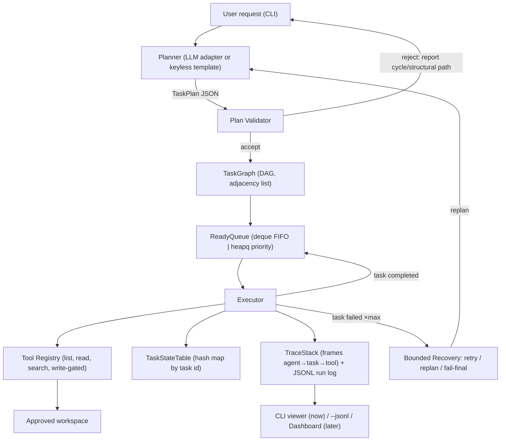

# FODS Agent Runtime (`fods-core`) — Design

> **Superseded scope note (2026-10-28):** the project master is now
> [`../../master.md`](../../master.md), with the research-to-brief scope. The
> approved implementation specification is
> [`../../implementation_architecture_and_demo_plan.md`](../../implementation_architecture_and_demo_plan.md).
> The generic file-agent and clean-rebuild decisions below are historical draft
> proposals; do not use them as the active scope.

**Date:** 2026-10-26
**Status:** Draft for team review
**Inputs:** `docs/master.md` (target definitions), `docs/research.md` (cited patterns),
`docs/prior-art.md` (external findings: open-multi-agent, PlanCompiler, Kahn-level
schedulers, event-sourced run ledgers), and lessons from the `rla` prototype in `main`.

---

## 1. Intent and why

This is the successor to the `rla` prototype. `rla` proved valuable and hard lessons —
a single event stream, content-hash caching, honest evaluation — but its executable core
is a **fixed linear 10-phase pipeline** with no scheduler, no task states, no plan
validation, and no queue. To a FODS reviewer, the data structures it lists are infra
around an LLM pipeline, not the engine itself. It is also slow: every build is LLM-bound
and free-tier quota stretches a full run across a day.

The new system rebuilds the project from scratch around the point of the course: a
**compact agent runtime whose engine is the data structures**. The LLM proposes a
structured plan; our runtime governs — validates, schedules, executes, traces, and
recovers within fixed bounds. Every demo scenario completes in seconds, keyless.

One line for the report: *the LLM suggests; the FODS runtime governs.*

## 2. Goals, non-goals, anti-goals

**Goals**

1. A runtime where DAG + cycle detection + topological ordering, ready queue,
   task-state machine, stack-based trace, and hash-map indexing are *load-bearing
   components*, each observable and forceable in a demo.
2. Plan validating before any tool executes: structural checks + cycle rejection with
   the cycle path printed.
3. Topological execution with visible ready-set evolution; FIFO vs one explicit
   priority rule comparison on the same plan.
4. Bounded recovery: per-task retry with a max attempt count, one replan budget, and a
   visible termination reason on every stop.
5. One event stream that feeds CLI display, `--jsonl` output, and (later) the web
   dashboard — they cannot drift. Events are append-only and replayable.
6. Keyless first-class mode: with no provider key, plans come from deterministic
   templates so all five demo scenarios still run.
7. Fast iteration: a build/doc cycle never depends on network or LLM.

**Non-goals** (for the first assessment)

- Parallel worker agents (deferred to the final milestone; the DAG structure plans for it).
- Full-text research or paper acquisition — that is `rla`'s job, not this engine's.
- Production security, auth, or multi-user anything.
- Speed benchmarks as an assessment metric (behavior + explanation beat speed).

**Anti-goals** (would make this a failure even if it technically works)

- Any data structure used for decoration (a heap no scheduler policy uses; a stack
  no trace frame is pushed to). If removing a structure changes nothing observable,
  it must not be in the code.
- Retry looping without bounds, or failures without a recorded decision.
- Interface-dependent runtime logic (the runtime must expose events, not know its UI).

## 3. Constraints

- Windows / PowerShell, Python 3.12, no Docker.
- Free-tier LLM quota is ~20 requests/day/model → the design must not *require* an LLM
  call for any demo scenario to run or be graded.
- First assessment due before the 20th → events-first interfaces, dashboard later.
- The team's proven patterns (single async-generator event stream, SQLite cache keyed
  by `prompt_hash`, content-hash resumability, honest reporting) may be reused as
  conventions; no `rla` code is imported — the engine is written fresh.

## 4. Decisions already made (team's calls)

| Decision | Choice |
|---|---|
| Language | **Python 3.12 only** (pydantic, typing, asyncio) |
| First interface | **Events-first**: emit `Event` via one async generator from day one; CLI viewer now, `--jsonl` always; web dashboard is a later layer that only renders events |
| LLM provider | **Provider-agnostic from day one**: a small `PlannerClient` protocol; concrete adapters behind an env-var choice; fully keyless degrade mode with template-generated plans |
| Repository | Dedicated branch `fods/agent-runtime` (this worktree); the engine is a **new clean package**, not a patch on `rla` |

## 5. My calls (reviewer can veto — none were pre-agreed)

1. **Package layout:** fresh top-level package `fods/` in `src/fods/` with submodule
   folders `plan/`, `sched/`, `exec/`, `tools/`, `trace/`, `cli/`, `llm/`, `store/`.
   The `rla` code stays untouched in this branch as reference and is removed only in
   the final-project cleanup milestone, after the new engine has its own complete
   test suite and demo.
2. **Task state machine:** `planned → ready → running → completed`
   with `running → failed → (retry|blocked|failed-final)`. `blocked` marks downstream
   tasks of a failed task (from the Kahn-level scheduler insight); `canceled` is a
   state so an invalid replan can retire tasks cleanly.
3. **Defaults:** `max_attempts = 3` per task, `max_replans = 1` per run,
   `max_total_steps = 25` per run — all env-overridable; every stop emits a
   `TerminationReason` (`completed | attempt_exhausted | replan_exhausted |
   step_budget_exhausted | invalid_plan | user_abort`).
4. **Ready queue:** `collections.deque` for FIFO; the priority variant is a `heapq`
   keyed on a single explicit rule (`static_priority, dependency_depth` tuple) so the
   comparison scenario stays explainable — never an "AI priority".
5. **Persistence:** append-only JSONL run log (event-sourced, replayable — mirrors
   DeepSeek Harness's audit idea and `rla`'s resumability); SQLite cache only around
   outbound LLM calls.
6. **Plan validation happens in one place and always first:** structural checks then
   cycle detection then readiness propagation — a plan that fails never touches a tool.

## 6. Architecture



### 6.1 Components (each maps to a FODS structure)

| Component | Structure it *is* | Made visible by |
|---|---|---|
| `plan/models.py` — TaskPlan, Task | pydantic dicts / hash map keyed by task id | unique-id rejection on duplicate |
| `plan/validate.py` — structural checks, **cycle detection with path reporting**, orphan/missing-dependency detection | directed graph + DFS (color-marking or Kahn) | “invalid plan: cycle a → b → c → a” before any tool call |
| `sched/graph.py` — `TaskGraph` (adjacency list), `ready_tasks()`, topological levels | DAG + Kahn's algorithm (in-degree counts) | readiness computation traced per completed dependency; levels shown as rounds |
| `sched/queue.py` — ready work | `deque` (FIFO) / `heapq` (priority) | order of execution + enqueued-at/ready-at stamps |
| `exec/state.py` — task state table | hash map `task_id → TaskRecord` | O(1) lookup shown in trace detail |
| `exec/runner.py` — execution + recovery | bounded loop over queue; retries with counter | attempt counters, termination reason events |
| `trace/frames.py` — nested frames | call stack (agent → task → tool) | indented tree view; failed push unwinds to caller frame |
| `trace/events.py` | single async event stream; append-only JSONL | same stream drives CLI, `--jsonl`, dashboard |
| `tools/registry.py` | hash map `name → Tool` with permission tag | registry dump; write tool requires explicit target file |
| `llm/planner.py` | protocol + adapters (env-configured) | provider name and call count in trace; zero calls in keyless mode |

### 6.2 Core loop

```text
request → plan (LLM or template) → validate
  reject → printed diagnosis, termination reason = invalid_plan, no tool call
  accept → TaskGraph → ready_tasks (Kahn in-degree sweep)
loop:
  pop ready task (FIFO or priority)
  push trace frame → set running → execute tool/call → record outcome
  completed → decrement dependents' in-degree → newly-ready tasks enqueue
  failed and attempts left → requeue as retry (state: failed → ready)
  failed and replan budget left → send failure context to planner, splice new subplan
  failed and budgets exhausted → delete not one tool run but mark downstream blocked,
                                  stop with a visible termination reason
```

## 7. The five demo scenarios (from master.md §7, unchanged)

1. Normal workflow: read → summarize → write; show DAG + topological order.
2. Parallel-ready work: two independent tasks ready simultaneously; join task waits for both.
3. Scheduling comparison: same ready set, FIFO vs `static_priority, depth` heap; show changed order.
4. Invalid plan: injected cycle; show detection *before any tool executes*.
5. Controlled failure: missing file or denied write; show attempts, retry policy, blocked downstreams, final result with reason.

Each scenario doubles as a test (`tests/test_s1_*.py … test_s5_*.py`).

## 8. Testing strategy

- Pure-structure tests without LLM or network: validator (cycles, orphans, duplicates),
  Kahn ordering, queue policy deltas, state-machine illegal transitions.
- Scenario tests replay canned traces to the CLI/JSONL renderer so UI and engine cannot drift.
- Snapshot tests for the event stream (a run emits the same canonical event sequence keyless-day-to-day).
- 80×24 TUI-style frame discipline is *not* carried over (CLI viewer is plain rich output; dashboard later).

## 9. Milestones (maps to master.md §8)

| M0 | Package skeleton, TaskPlan model, validator with cycle path reporting — no LLM needed |
| M1 | TaskGraph + Kahn readiness + FIFO runner + first working keyless end-to-end scenario 1 |
| M2 | State machine + bounded retry/replan + trace stack + JSONL/CLI views (scenarios 4, 5) |
| M3 | LLM planner adapter behind the protocol (any provider), template fallback, tool registry gating |
| M4 | Priority queue variant + scenario 3 comparison; scenario 2 (fan-out/fan-in sequential determinism) |
| M5 | Web dashboard rendering the same event stream; `rla`-removal cleanup for the final repo |

## 10. Left to the builder

- Exact pydantic model field sets (plan schema like master.md §5.2 flow, but builder refines).
- CLI command names and output formatting.
- Event payload schemas (stability *within* a run matters; cross-run stability is only needed for the snapshot tests).
- Whether the replan validator re-runs on the spliced subplan (it must — but where in the sequence is builder's call).
- Library choices (rich, httpx) may follow the team's existing taste, but no framework dependency for the engine core.

## 11. References

- `docs/master.md` — authoritative target definition.
- `docs/research.md` — cited framework evidence (ADK, LangGraph, OpenAI SDK, OpenCode, DeepSeek Harness).
- `docs/prior-art.md` — *to be written next*: the external findings (open-multi-agent event-driven executor, PlanCompiler static validator, Kahn-level parallel scheduling, event-sourced ledgers, Dagent/qpiai planning flow).
- `main` branch — `rla` prototype (patterns to imitate, not to import).
