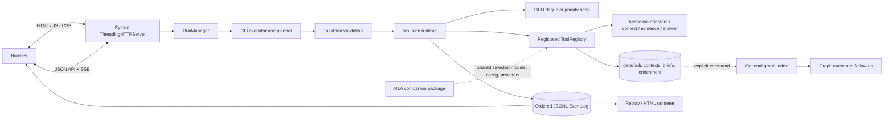
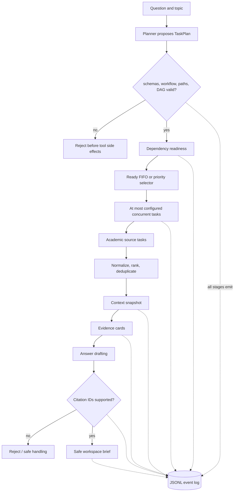
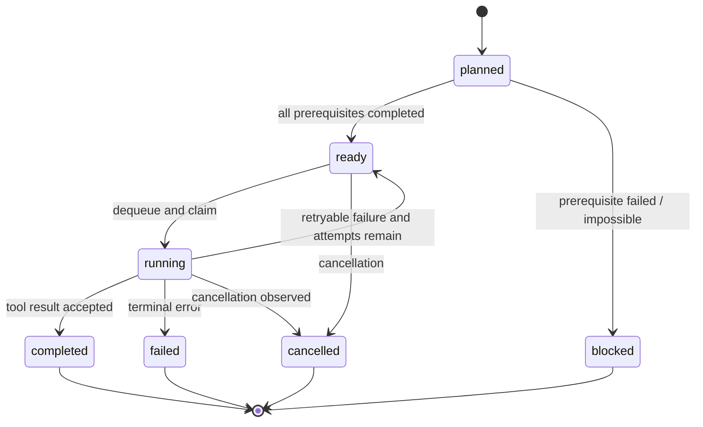
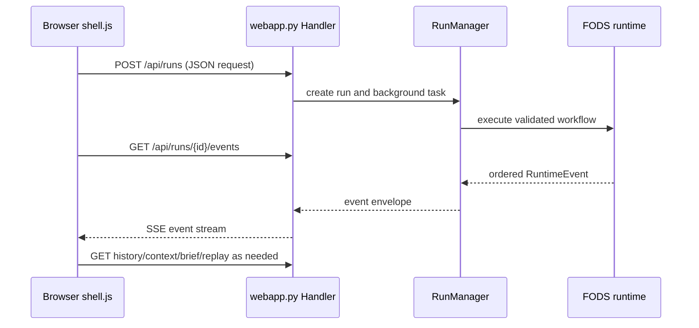
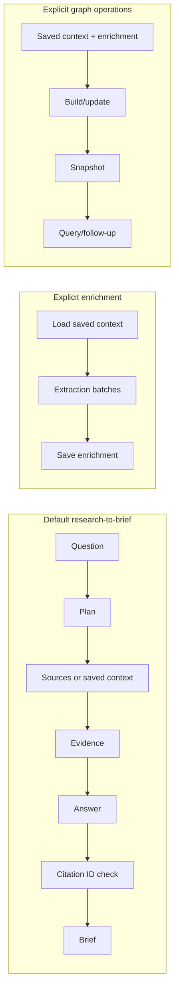
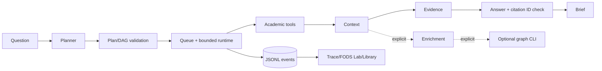

# FODS Research Studio — Complete Team Handover & Showcase Pack

**Showcase date:** 3 November 2026. This single document combines the teammate onboarding, architecture, FODS structures, research pipeline, frontend, operations, demo, acceptance evidence, limitations, Q&A, and role handoff.


---

## FODS Research Studio — Team Handover

**Showcase date:** 3 November 2026 · **Checkout inspected:** `codex/fods-mvp-acceptance` at `f533ae1ea8b0af7bdf99a6fee0d9f44d3b267ed8`.

FODS Research Agent turns a bounded research question into a paper context, selected evidence, a citation-ID-checked answer, and a saved brief. Its academic contribution is to use data structures as working controls over an agent: **“The LLM suggests; the FODS runtime governs.”** The LLM can propose structured tasks; FODS validates them and owns tool access, dependency readiness, scheduling, retries, citation checks, and safe output.

### What is here

The primary deliverable is the FODS research-to-brief application and the Research Studio browser interface. FIFO and priority ready queues, a dependency DAG, bounded asynchronous workers, a task-state dictionary, per-task trace stacks, and ordered JSONL events are implemented. Research retrieval, evidence selection, deterministic or configured answer drafting, brief persistence, replay, optional extraction/enrichment, and an explicit optional graph CLI are also present. `rla` remains a separate companion pipeline/package.

The backend regression and CI gates have passed. That does **not** establish live provider-backed browser acceptance. The fresh-source browser acceptance and production screenshots were not verified in this checkout. The persisted runs that look like completed live research in screenshots are actually enrichment workflows; see [run provenance](#persisted-run-reconciliation).

### Start here and read in this order

1. [Project overview](#project-overview)
2. [System architecture](#system-architecture)
3. [FODS structures and algorithms](#fods-data-structures-and-algorithms)
4. [Research pipeline and AI](#research-pipeline-and-ai-integration)
5. [Frontend and visualization](#frontend-and-visualization)
6. [Repository map and code walkthrough](#repository-map-and-code-walkthrough)
7. [Windows setup and operations](#windows-setup-and-operations)
8. [Showcase runbook for 3 November](#showcase-runbook-3-november-2026)
9. [Testing and evidence](#testing-acceptance-and-evidence)
10. [Technical challenges and decisions](#technical-challenges-and-decisions)
11. [Limitations and roadmap](#known-limitations-and-roadmap)
12. [Viva and team Q&A](#viva-and-team-qa)
13. [Team role handoff](#team-role-handoff)
14. [Quick reference](#quick-reference-fods-showcase)

#### Five-minute onboarding

Read the first two sections of this page; skim the structure summary in [03](#fods-data-structures-and-algorithms); run `\.venv\Scripts\python.exe -m fods.cli --help`; then open the [demo runbook](#showcase-runbook-3-november-2026) and memorize the live-versus-replay distinction. If only one claim sticks: the event trace proves runtime actions; a mode badge by itself does not prove fresh network retrieval or model activity.

### Recommended operational guides

- [Windows setup](#windows-setup-and-operations)
- [Showcase runbook](#showcase-runbook-3-november-2026)
- Existing [live demo guide](fods_live_demo_guide.md) and [artifact inventory](fods_demo_artifact_inventory.md)
- [Architecture and demo plan](implementation_architecture_and_demo_plan.md)

### What is not complete

Manual live browser acceptance, a freshly acquired source set proven by request telemetry, and genuine production screenshots remain unverified. Current Ollama availability was reported unreachable during the latest acceptance check; Gemini use requires explicit opt-in. Human review of the retrieval benchmark remains pending. The UI does not record worker identities or exact internal heap-array state. These limits and the safe presenter claims are collected in [11](#known-limitations-and-roadmap).

### Current checkout and preservation note

The branch is `codex/fods-mvp-acceptance`, HEAD is `f533ae1ea8b0af7bdf99a6fee0d9f44d3b267ed8`, matching the accepted backend baseline. There were already modified and untracked files, including the production frontend work, tests, assets, checkpoint docs, and README. This handover preserves them; no application code, saved research, benchmark data, or runtime artifacts were changed. See [09](#testing-acceptance-and-evidence) for working-tree and verification details.

### What this project does not claim

It does not claim that a `live` badge proves live source acquisition; that a successful enrichment run is a research-to-brief run; that ID-valid citations are semantically entailed; that abstract records are full-text papers; that screenshot mockups are production captures; or that passing tests proves live provider/browser acceptance or retrieval quality.


---

## Project Overview

### Problem and purpose

Research-agent execution can be hard to inspect: a planner may emit tasks, but users often cannot tell why work was ready, which task ran next, whether a source failed, what evidence supported an answer, or whether a displayed result came from a model, a fixture, a cache, or replay. FODS makes these steps observable and places control in explicit data structures and runtime rules.

The project demonstrates a bounded academic-research workflow for a Fundamentals of Data Structures (FODS) course. Its central idea is **“The LLM suggests; the FODS runtime governs.”** A proposed plan is data to validate, not executable authority.

### Objectives

| Objective | Meaning in this project |
|---|---|
| Academic | Show DAG readiness, queue policies, bounded concurrency, task state, stack behavior, and event replay in an actual application. |
| User-facing | Gather/reuse paper metadata and abstracts, select evidence, draft an answer, validate citation IDs, and save a brief. |
| Technical | Keep planning, validation, registered tools, event persistence, source/provider configuration, and output safety as distinct responsibilities. |
| Demonstration | Let a teammate inspect runtime events and explain what is recorded versus reconstructed or unavailable. |

### Current user journey: research to brief

1. The user submits topic/question and chooses live or simulation, context policy, scheduling, concurrency, and bounded research settings.
2. The planner supplies a structured task plan. A deterministic plan is used when the chosen planner is deterministic; a configured Ollama planner can be used for live mode.
3. `validate_plan` checks task IDs, tool registration, argument schemas, dependency references, acyclicity, workflow shape, and safe output destination before side effects.
4. The runtime readies root tasks and queues only tasks whose prerequisites completed.
5. Registered academic-source tools retrieve bounded records; source failures can yield partial results.
6. Candidate records are normalized, ranked/deduplicated, and merged into a reusable context snapshot.
7. Evidence selection returns a bounded set of evidence cards. Answer drafting can be deterministic or use the opted-in configured answer model.
8. Citation validation checks that cited IDs belong to selected evidence. It is not semantic entailment verification.
9. The output guard checks the workspace-relative destination and writes a new brief only after the required checks.
10. Events and artifacts can be reopened in Research Studio or rendered from the event log with replay.

Any provider, source, or task can fail or be unavailable. Partial source completion is represented; the interface should not be read as a promise that every step succeeded.

### Scope and separate workflows

FODS is the primary course application (`fods` / `python -m fods.cli`). The `rla` CLI is a companion research-literature pipeline with different orchestration, graph lineage, TUI, and evaluation responsibilities; it is not an alias for FODS.

The normal browser/CLI journey is research-to-brief. `fods enrich` is a separate, explicit workflow that loads an already saved context, runs extraction batches, and saves derived enrichment. `fods graph build/update/query/stats/follow-up` is another explicit workflow that indexes saved context and enrichment. Neither enrichment nor graph construction is implied by a normal research run. See [04](#research-pipeline-and-ai-integration) and [02](#system-architecture).

### Modes and provenance vocabulary

- **LIVE** means the persisted run mode is live. Qualify it with actual source/model evidence and whether the data was fresh or reused.
- **SIMULATION** uses deterministic controlled records/planning; it is useful for algorithms but is not live literature retrieval.
- **REPLAY** projects recorded historical events and makes no source/model calls.
- **SYNTHETIC** describes artificial teaching/test records; never present them as academic search results.
- **FAILED / PARTIAL / UNKNOWN** describe outcomes or provenance gaps; preserve these labels.

Provider configured, provider reachable, provider invoked, and successful provider completion are separate facts. See [04](#provider-and-data-provenance-terms).


---

## System Architecture

### Components and boundaries



This shows the actual Python-served browser and the principal call boundaries. It does not imply a React frontend, a separate Node development server, or an automatic graph stage.

### Research question to brief



This is the default research workflow. Source acquisition may be partial; configured models may be skipped or fail; deterministic drafting is possible. The diagram does not promise full text or semantic citation entailment.

### Runtime lifecycle



`run_plan` owns state changes, scheduling, retry bounds, and event emission. There are bounded asynchronous tasks, but no stable worker ID is recorded, so the UI cannot attribute work to a named worker.

### Browser, API, and SSE



The server serves static assets and JSON endpoints and streams event envelopes with `text/event-stream`; the browser does not schedule tasks. The sequence is representative, not a guarantee that every event is a separately correlated model/source span.

### Three distinct workflows



The enrichment graph matching the visible screenshot is not the research-to-brief graph. Graph build/query are CLI operations against saved material, not automatic browser stages.

### Key implementation locations

`src/fods/cli.py` registers CLI workflows and builds execution dependencies; `planner.py` resolves plan sources; `models.py` defines `TaskPlan`, `Task`, `TaskRecord`, and `TaskState`; `plan.py` validates contracts and DAG; `runtime.py` schedules and emits events; `tools.py` registers source/context/evidence/output tools; `events.py` persists ordered JSONL; `webapp.py` implements server/API/SSE/history/replay; `src/fods/web/` is the production shell. `knowledge_graph.py` and `graph_followup.py` implement explicit graph capabilities. `src/rla/` is the companion package.

For the full code walk, see [06](#repository-map-and-code-walkthrough).


---

## FODS Data Structures and Algorithms

The structures below are runtime controls, not decorative diagrams. Their implementation is primarily in `src/fods/models.py`, `plan.py`, `runtime.py`, and `events.py`; the production projection/rendering is in `src/fods/web/shell-core.js` and `shell.js`.

### Core structures

| Concept | Implementation and operation | Runtime effect and visible evidence | Limits / complexity |
|---|---|---|---|
| Dependency DAG | `Task.depends_on`; `validate_plan` checks references and `_cycle_path`, then uses Kahn-style indegrees and dependants to return topological levels. | `plan_validated`, `task_ready`, `dependency_updated`, state transitions. FODS Lab draws nodes/edges and readiness from plan + events. | Validation is O(V+E) aside from validation/sorting work; DFS cycle path also O(V+E). A task is eligible only after all required dependencies complete. |
| FIFO queue | `FifoQueue` uses `collections.deque`; `put` appends and `get` removes from the left. `make_queue("fifo")`. | `queue_updated`, `task_dequeued` expose operations/snapshots. UI can show recorded order/front/rear when known. | O(1) append/popleft. FIFO ignores task priority. |
| Priority queue | `PriorityQueue` uses `heapq` list entries `(-priority, insertion_sequence, task_id)`. `make_queue("priority")`. | Dequeue events establish selection order; snapshot is sorted selection order and records priority/sequence. | O(log n) insertion/removal, O(n log n) current snapshot sort. It is not a dump of the internal heap array and must not be drawn as one. Higher integer priority wins; sequence breaks ties FIFO. |
| Bounded async execution | `run_plan` creates asyncio tasks while respecting configured concurrency (CLI range 1–8; runtime validates positive). | Task start/completion intervals can be projected as concurrent activity. `task_started` and terminal events are actual. | Parallelism is bounded; no persistent worker identity is recorded. UI may show overlapping task activity but cannot truthfully label worker 1/2 or assignment. |
| Task-state dictionary | `RunResult.states: dict[str, TaskRecord]`, keyed by task ID; records state, attempts, result, error. | `task_ready`, `task_started`, `task_completed/failed/blocked/cancelled`; UI projects task-ID→state. | Expected average O(1) dictionary access. No hash buckets or collision behavior are captured or visualized. |
| Per-task stack | `TraceStack` has a frame list rooted at `run:<id>`; `push` appends and `pop` removes last. | `stack_push`/`stack_pop` contain stack frames; UI reconstructs stack at the selected event cursor. | Append/pop at end O(1). Each task's trace is isolated; cursor view is reconstructed from history, not an OS call stack. Missing events mean incomplete projection. |
| Event log | `EventLog` appends monotonically sequenced event records and writes JSON Lines. `read_events` reads records; replay builds a historical projection. | Event sequence is the source for trace inspection/playback, state/queue/stack projection, and replay. | Append is amortized O(1) plus serialization/I/O. Replay scans O(E) events. An event log is historical evidence, not a ready queue and does not undo/re-execute runtime work. |

### DAG details

Each directed prerequisite edge points from a dependency to a dependant in the UI model. `validate_plan` rejects duplicate IDs, unknown/self-dependencies, invalid tool args, and cycles before side effects. It computes topological levels using indegree counts and a FIFO deque. `run_plan` adds tasks to the ready queue only when prerequisites are satisfied. Fan-out allows independent sources to become ready together; fan-in waits for all prerequisites. For research workflows, validators also enforce the evidence → answer → citation check → brief write chain. See `src/fods/plan.py` and `tests/test_fods_phase2_plans.py`, `tests/test_fods_runtime.py`.

### Scheduling policies

The CLI accepts `--schedule fifo|priority`. FIFO preserves ready insertion order. Priority uses static integer task priorities (schema range 0–100), with insertion sequence as a stable tie-break. The UI receives snapshots/operation events; it does **not** have the precise internal heap array arrangement after each mutation. Saying “the heap selected this task next” is accurate; claiming the visible tree is the real binary heap is not.

### Concurrency, retries, and stacks

`run_plan` limits in-flight tasks, tracks attempts on each `TaskRecord`, and retries only retryable tool errors within the task-attempt limit. `ToolRejectedError` carries a recovery action; policy/evidence rejection is not blindly retried. Each task owns a trace stack, so concurrent stack frames do not interleave. Because no worker identity exists, concurrency visuals are task intervals inferred from event timestamps/order, not worker assignment diagrams.

### Other actual algorithms

- `research.py`: `deduplicate_candidates` uses strong identifiers and records multiple source identities; ranking uses lexical/query signals and deterministic tie-breaks. Candidate ranking is not a human relevance judgment.
- `plan.py`: Kahn topological levels plus DFS cycle path.
- `tools.py`: bounded evidence selection and citation-ID validation; this validates identifier membership, not semantic support.
- `runtime.py`: heap/deque scheduler, bounded retries, state transitions, event emission.
- `knowledge_graph.py`: explicit graph snapshot/index construction, validation, querying, statistics; this is separate from the task dependency DAG.
- Common dictionaries, lists, and sets hold maps, ordered event/paper collections, dependencies, identifiers, and deduplication indexes. No separate hash-table visualizer exists.

### Showcase mapping

| FODS concept | Backend implementation | Runtime operation | Event evidence | Frontend view |
|---|---|---|---|---|
| DAG | `Task.depends_on`; `validate_plan` | validate/readiness/fan-in | `plan_validated`, `task_ready`, `dependency_updated` | FODS Lab DAG, role/readiness/state |
| FIFO | `FifoQueue`/`deque` | append + left-pop | `queue_updated`, `task_dequeued` | Queue panel; order only when recorded |
| Priority heap | `PriorityQueue`/`heapq` | priority pop + stable sequence | queue/dequeue payload | Priority panel; not raw heap array |
| Bounded concurrency | `run_plan` | launch up to configured maximum | task start/finish intervals | Concurrent activity, without worker labels |
| Task-state map | `RunResult.states` | ID-keyed state lookup/update | task transition events | Task-state map |
| Per-task stack | `TraceStack` | push/pop nested activity | `stack_push`, `stack_pop` | Stack panel at shared cursor |
| Event log | `EventLog` | ordered append/read | `seq`, `kind`, payload | Trace, inspector, replay |

#### Complexity caveat

The figures above describe the actual operations/data structures, not end-to-end wall time. Network and model calls dominate many runs; no benchmark claim follows from asymptotic analysis alone.


---

## Research Pipeline and AI Integration

### What the planner and models do

`src/fods/planner.py` defines the planner protocol, `LLMPlanner`, canonicalization, and `deterministic_plan`. The planner's output becomes a `TaskPlan`; `src/fods/plan.py` and Pydantic schemas validate it before tool execution. Live browser submissions reject fixture planning. A deterministic planner is not a model call. A model-configured string or UI provider badge proves configuration only.

In the research workflow, a configured planner proposes task structure/query tasks. Source tools perform academic search; evidence selection is bounded; answer drafting may use a deterministic draft or a configured Gemini route. Gemini final answering requires both the key and `RLA_FODS_ALLOW_GEMINI=1` in the process environment. Enrichment uses a separate structured Ollama stage where configured. Model events in JSONL are the evidence that a model request was instrumented as invoked/completed.

### Retrieval and context

`src/fods/sources.py` selects source names and builds adapters; registered search tools live in `src/fods/tools.py`. The observed research plan includes Semantic Scholar, OpenAlex, and arXiv. Source tasks are bounded by profile and request limits; source quorum can allow successful partial completion while unavailable sources are recorded. `research.py` builds query plans, deduplicates candidates, and ranks results. Retrieved records are metadata/abstracts unless a record says otherwise; the app does not imply full-text retrieval.

Context modes include automatic selection, build, reuse, and refresh; API/CLI paths can bind reuse to a context ID/hash. A saved context stores normalized paper records, provenance, snapshot identity, and timestamps as available. Fresh-source mode uses a new source cache for the run. It does not itself prove an API request occurred: corroborate with source output and request telemetry. Cached/configured source mode can reuse previous responses.

Evidence selection produces a bounded collection of source-linked cards. Drafting creates an answer from those cards. Citation validation checks each marker against selected evidence IDs and the write tool enforces the validated chain and safe workspace path. This is citation-ID integrity, not semantic support/entailment review.

### Provider and data provenance terms

| State | Evidence required | What it does not prove |
|---|---|---|
| Configured | Settings/API reports model/provider name or opt-in | Reachability, invocation, or success |
| Reachable | Health/check request receives a response | Successful task use or correct output |
| Invoked | A model/source call start event or attributable request record | Successful completion |
| Completed | Completion event with result summary or successful source task output | Freshness unless cache policy/request evidence says so |
| Fresh | Fresh cache policy plus request/HTTP attempt evidence and source result | Retrieval relevance or answer quality |
| Cached | Cache hit/reuse metadata or configured cache path | A request to the provider during this run |
| Fixture/synthetic | Deterministic fixture planner/data | Academic provenance or live API access |
| Replay | Historical event envelope / replay source ID | Re-execution of sources or models |
| Real model answer | Answer model call with stage/provider/model and completed output | Semantic correctness |

### Persisted-run reconciliation

Files `data/fods/runs/3a75b2fd8b15.jsonl`, `4529288e085d.jsonl`, and `721c4c1d155b.jsonl` exist. The typed candidate `452928e085d` does not; the actual file is `4529288e085d` (extra `8`). All three are `mode=live`, `planner=deterministic`, topic “Graph attention networks,” question “Extract supported concepts, methods, findings, and limitations.” Their DAG is enrichment, not research-to-brief.

| Run | Persisted evidence | Correct classification |
|---|---|---|
| `3a75b2fd8b15` | 120 events; tasks `load_context`, five `extract_*`, `save_enrichment`; 7/7 completed. Loaded 5 papers from an existing schema-v3 context; 5 `model_call_completed` events identify Ollama `ollama/qwen3:4b`, stage `fods_extraction`; each batch says `cache_reused=false`. `run_finished` reports `http_attempts=0`; no academic source tasks, evidence, answer, citation-check, or brief write. Enrichment artifact path is recorded under `data/fods/enrichments/`. | **LIVE — partial provider execution** (real Ollama extraction is recorded, but no fresh source acquisition or answer). Suitable to explain enrichment/replay only. |
| `4529288e085d` | 120 events; same enrichment task shape; 7/7 completed; loaded 5 existing-context papers; 5 Ollama extraction completions; zero HTTP attempts; saved enrichment artifact. | **LIVE — partial provider execution**; not a fresh investigation/brief. |
| `721c4c1d155b` | 84 events; `load_context`, three extraction batches, save; 5/5 completed; loaded 3 existing-context papers; 3 Ollama extraction completions; zero HTTP attempts; saved enrichment artifact. | **LIVE — partial provider execution**; not a fresh investigation/brief. |

The workflow shape matches the explicit `fods enrich --topic … [--context-id …] [--model …]` path in `src/fods/cli.py`: load saved context → batches → save enrichment. The event schema does **not** record whether the originating invocation was the CLI or another internal caller, so exact entrypoint is **Not recorded**. The current browser API exposes research run submission and replay, not enrichment submission. The JSONL artifacts exist and the CLI replay path can render them; a browser replay of each candidate was not manually verified in this handover.

The `live` label is true metadata, but it describes the mode. The screenshot's `load_context → extract_01…extract_05 → save_enrichment` visualization is exactly the optional enrichment workflow. All three saved context snapshots exist and contain academic metadata/abstract records (source labels include OpenAlex, arXiv, and Crossref); they were loaded, not freshly acquired in these runs. Each candidate has zero `evidence_selected` and zero `brief_saved` events. Paths embedded in old event payloads may contain a machine-local absolute path; presenters should show relative artifact names, not copy personal paths into shared docs.

The repository also contains normal research JSONL traces. `103d5e31ec6b` is live with planner metadata `ollama`, has a repaired/validated research plan and partial source set with two successful sources and Semantic Scholar unavailable; it completed with partial sources in about 31 s. However the trace lacks explicit model call events and HTTP-attempt telemetry, so it does **not** establish which provider call succeeded or fresh network activity. Other fresh-policy traces include `b1820cc8b0e5` and `f593984df9b7`; they likewise lack provider/request instrumentation needed to prove fresh network activity. No normal live run here proves a full provider-backed browser run. Treat historic traces as **UNKNOWN — insufficient provenance** for fresh-source/model claims.

The local `5f0bf2d0b68d` fixture trace is `mode=simulate`, `planner=fixture`, with 3 source-labelled fixture tool results (example.org URLs), 4 context papers, 4 evidence cards, citation IDs accepted, and a saved brief. It is useful as **SIMULATION**, not real literature research.

### Errors, retries, fallback

Source adapters may fail independently; runtime records failed/unavailable tasks and can finish partial research when source quorum and workflow conditions are met. Runtime tool retries are bounded. LLM provider routing/fallback details in the companion `rla` package do not imply that a FODS run used fallback; use that run's actual events. `RLA_FODS_ALLOW_GEMINI` is an explicit FODS answer gate, not a provider-health test. Do not increase retry counts to work around daily quota.

Related: [Architecture](#system-architecture), [Operations](#windows-setup-and-operations), [Limitations](#known-limitations-and-roadmap).


---

## Frontend and Visualization

### Production interface

The active shell in `src/fods/web/index.html`, `shell.js`, `shell-core.js`, and `styles.css` has four navigation areas: **Research, Trace, FODS Lab, Library**. The classic workbench remains at `/?legacy=1`. The server provides the assets; this is plain browser JavaScript/HTML/CSS, not React, Next.js, or TypeScript.

- **Research:** new investigation form, question/topic, live or deterministic simulation, planner/schedule/concurrency/source limits, context reuse, fresh-source control, provider configuration, progress, selected-run question, answer, evidence and brief link.
- **Provider display:** names and key-configured state are reported from `/api/config`; the UI explicitly says “Configured · reachability not checked.” A model label is not evidence of a completed request.
- **Trace:** recorded events, filters/details, event count, mode and run identity. The answer/model/evidence are projected from the selected run’s events.
- **FODS Lab:** plan DAG, topological levels, queue/order, task-state map, task stack at the shared event cursor, playback/step controls, and concurrent task activity reconstructed from event timing/order.
- **Library:** persisted runs and saved contexts. Selecting a run calls the replay API; selecting a context fills the new-investigation draft for reuse.

The question shown with the selected investigation comes from its `plan_received` event. The form is explicitly a **New investigation** composer and is independent: selecting/replaying a past run does not turn the composer into that run. The mode badge follows the selected run (or says replay); form choices belong to the next submission. Before presenting, read the run ID and recorded run question next to the badge. This is a deliberate separation in the current code, though a presenter can still confuse a new draft with the selected result if they ignore the labels.

### API and streaming

`src/fods/webapp.py` uses `ThreadingHTTPServer`. Verified routes include `GET /api/health`, `/api/config`, `/api/history`, `/api/contexts`, run details/events, and `POST /api/runs`, `/api/replay`; active runs can be cancelled with `DELETE /api/runs/{12-hex-id}`. `POST /api/runs` validates `NewRun`, starts a background workflow, and returns run metadata. `/api/runs/{id}/events` serves Server-Sent Events (SSE); `shell.js` uses `EventSource`, appends the event, and renders the current run. Replay envelopes include `run_kind=replay` and the original `source_run_id`. The event sequence updates the shared cursor; backward stepping changes the view only and never rewinds execution.

### D3 and SVG: precise implementation

The vendored local packages are `d3-path` 3.1.0 and `d3-shape` 3.2.0, with license files and package description in `src/fods/web/vendor/`. They are loaded same-origin by `index.html`. `shell.js` uses `window.d3.line()` with `curveBumpX` to calculate curved dependency-edge path geometry. The shell JavaScript creates and updates the SVG elements and owns the DOM renderer. Node placement comes from runtime-derived topological levels and local shell layout logic.

D3 does **not** provide a full DAG layout engine here; there is no React integration, D3 hierarchy, force layout, zoom/pan, or D3-managed transitions. D3 is currently used for edge path generation. This is a pragmatic focused library integration, not the full intended visualization stack.

### Actual, projected, unavailable

| Visual item | Provenance |
|---|---|
| Task IDs, dependencies, recorded task transitions, tool/model event payloads | Directly recorded when the corresponding event exists. |
| Queue snapshot/selection order | Reconstructed from recorded queue/dequeue events; missing history must be shown as unknown, not empty. |
| Task-state map and per-task stack | Projection of plan and event history at the selected cursor. Not the process's current Python dictionary/stack object. |
| Concurrent task intervals | Inferred from starts/completions and timestamps/order; there are no worker IDs or assignments. |
| Priority heap | Queue selection view; no internal heap-array snapshot. |
| Event correlations | Some event types include activity/task/stack identifiers, but the schema does not provide universal correlation for every source/model request. |
| Source/model timeline | Show only recorded events. Historic traces missing source HTTP/model events cannot be upgraded to proven provider activity by UI labels. |

No production screenshots were captured in the verified acceptance evidence. Files under `design/prototypes/fods-research-studio/screenshots/` are prototype images; do not insert or label them as production captures. See [screenshot inventory](fods_screenshot_inventory.md).


---

## Repository Map and Code Walkthrough

### Main paths

| Path | Responsibility / key symbols | Tests and change cautions |
|---|---|---|
| `src/fods/cli.py` | Typer CLI; `preflight_command`, `run_command`, `enrich_command`, `replay_command`, `serve_command`, graph commands; `_execute` wires the run. | `tests/test_fods_phase2_plans.py`, `test_fods_research.py`, CLI/acceptance tests. Verify flags with `--help`; don't confuse CLI and web options. |
| `src/fods/models.py` | `Task`, `TaskPlan`, `TaskState`, `TaskRecord`, `RunResult`. | Runtime/plan tests; schema changes affect planner, API and event consumers. |
| `src/fods/planner.py` | `Planner`, `LLMPlanner`, `canonicalize_llm_research_plan`, `deterministic_plan`. | Plan/acceptance/provider tests; keep model output non-authoritative. |
| `src/fods/plan.py` | `validate_plan`, `_cycle_path`, workflow-specific chain validation. | `test_fods_phase2_plans.py`; validation precedes all tool side effects. |
| `src/fods/runtime.py` | `FifoQueue`, `PriorityQueue`, `TraceStack`, `run_plan`; scheduler, retries, state and events. | `test_fods_runtime.py`; preserve deterministic ordering and event semantics. |
| `src/fods/events.py` / `tracing.py` | `RuntimeEvent`, `EventLog`, `read_events`, `traced_model_call`. | `test_fods_tracing.py`; schema changes affect persistence/replay/API. |
| `src/fods/research.py`, `sources.py` | Profiles/query planning, candidate dedup/ranking, source selection and adapter pool. | `test_fods_research.py`, acquisition/benchmark tests; freshness and provider proof need telemetry. |
| `src/fods/tools.py` | Pydantic tool args, `ToolRegistry`, `create_registry`, context/evidence/answer/citation/output/enrichment tools. | Runtime/research/enrichment tests; tool registration is an execution capability boundary. |
| `src/fods/paths.py`, `safety.py` | Workspace path resolution, payload redaction/safe serialization. | Safety/path tests; preserve Windows/POSIX traversal defenses. |
| `src/fods/webapp.py` | `NewRun`, `RunHandle`, `RunManager`, `make_server`, JSON routes, SSE, history/context/replay. | `tests/test_fods_webapp.py`; avoids credentials in browser, handles local persisted artifacts. |
| `src/fods/web/` | Production HTML/CSS/JS, `shell-core.js` projections, `shell.js` SVG/UI and D3 edge paths; pinned vendor packages. | `test_fods_frontend_shell.py`, webapp tests; no build step or framework. |
| `src/fods/visualize.py` | `write_run_html` historical event rendering. | `test_fods_visualize.py`; replay is read-only to providers. |
| `src/fods/knowledge_graph.py`, `graph_followup.py` | Explicit graph snapshot/index, validation, query and deterministic follow-up routing. | graph tests; do not overwrite original schema-v1 graph casually. |
| `src/fods/benchmark.py`, `benchmarks/` | Collection/scoring of retrieval review packs and review CSVs. | benchmark tests/docs; blank human labels mean no quality claim. |
| `src/rla/` | Separate literature pipeline, provider/config/cache/source/graph/eval/TUI components. | `tests/test_p<N>_*.py`; read package boundary before changing. |
| `tests/` | Runtime, API, frontend projection, source/provider, graph and RLA coverage; `tests/fixtures/fods_frontend/demo_data.json` supplies frontend fixtures. | Fixtures are synthetic; test pass is not live-provider evidence. |
| `docs/`, `design/`, `.github/workflows/` | Operational/acceptance history, prototype artifacts, CI. | Distinguish dated checkpoint/history from current source and records. |

### Suggested reading sequence

1. `src/fods/cli.py`: see command registration and `_execute` wiring.
2. `src/fods/webapp.py`: inspect `RunManager.start`, history/context/replay and `make_server` handlers.
3. `src/fods/web/index.html`, `shell.js`, `shell-core.js`: understand boot, form submission, SSE and projections.
4. `cli.py` `run_command` and `webapp.py` run construction: compare CLI/API inputs.
5. `planner.py`: compare model-backed and deterministic planning.
6. `plan.py`: inspect tool schema, DAG, cycle and workflow validation.
7. `runtime.py`: follow queue selection, task state, worker bounds and retries.
8. `tools.py`, `sources.py`, `research.py`: follow acquisition and registered tool behavior.
9. `tools.py`: follow context, evidence, answer, citation validation, brief path and enrichment.
10. `events.py`, `tracing.py`, `visualize.py`: persistence, provider instrumentation and replay.
11. `shell-core.js` and `shell.js`: see DAG/queue/state/stack projections and SVG rendering.
12. Relevant tests: start with `test_fods_runtime.py`, `test_fods_phase2_plans.py`, `test_fods_webapp.py`, `test_fods_frontend_shell.py`, and `test_fods_tracing.py`.

Do not treat generated `__pycache__` files or `.pytest-tmp` as source. Avoid reading `.env`; `.env.example` is the safe variable template.


---

## Windows Setup and Operations

All commands below use the checkout's virtual environment. The `.venv` exists in this machine; a fresh clone should create it. No credentials are included here. Do not print `.env` contents.

### Install

```powershell
Set-Location D:\Research_AI_Agent-fods
py -3.12 -m venv .venv                 # fresh clone only
.\.venv\Scripts\Activate.ps1
python -m pip install -e ".[dev,tui]"
Copy-Item .env.example .env            # fresh clone only; edit privately
python --version
python -m fods.cli --help
```

`pyproject.toml` requires Python 3.11+; 3.12 is the verified version recorded in project docs. The FODS browser server has no independent `npm run dev` requirement.

### Offline preflight

```powershell
python -m fods.cli preflight --profile quick
python -m fods.cli preflight --profile deep
```

These commands are verified CLI help and source behavior: preflight reports selected sources, pacing and hard attempt ceiling without sending network requests. It does not test provider reachability.

### Provider configuration

Use `.env.example` as the variable reference; do not display `.env`. FODS reads common `RLA_…` settings through `rla.config`. The selected Ollama model in the latest acceptance report is `ollama/qwen3:4b`. If setting up a local instance:

```powershell
ollama --version
ollama list
ollama pull qwen3:4b                 # only if not already installed
$env:RLA_OLLAMA_URL = "http://localhost:11434"
Invoke-RestMethod http://localhost:11434/api/tags
```

`ollama serve` can start the service in a separate terminal if the desktop service is not running. Model pull requires network and may take time. The prior acceptance reported Ollama unreachable; it is not re-verified by this documentation task.

For Gemini, set `GEMINI_API_KEY` privately in `.env` or the process environment, configure the answer model (commonly `gemini/gemini-2.5-flash`), then explicitly opt in only when intended:

```powershell
$env:RLA_FODS_ALLOW_GEMINI = "1"
```

The opt-in is read directly from the process environment. Set variables in the **same PowerShell session** that starts the CLI/server. Key configuration does not prove reachability; a Gemini call can consume quota. Do not run an uncached doctor probe just to prepare this handover.

### Fresh academic-source browser run (provider-dependent)

The browser can submit live research; academic sources are selected by current source/config and preflight. Fresh source mode bypasses the source cache, but should only be used after providers/network/source availability are checked. `--fresh-sources` exists on CLI; the browser exposes the corresponding checkbox. A fresh setting alone is not proof of completed HTTP requests; inspect trace telemetry and source outputs.

### Start the browser server

```powershell
python -m fods.cli serve --host 127.0.0.1 --port 8765
```

Open `http://127.0.0.1:8765/`. Classic workbench: `http://127.0.0.1:8765/?legacy=1`. Server startup command is supported by current CLI help. Existing acceptance documentation reports that local loopback/browser access was restricted in this environment; server startup alone is not proof of browser access.

Check a port before use:

```powershell
Get-NetTCPConnection -State Listen -LocalPort 8765 -ErrorAction SilentlyContinue
```

If occupied, stop the process you own or use another port, for example `--port 8766`, and navigate to that URL. Stop the server with Ctrl+C. It binds to loopback by default. Web artifacts live below `data/fods/`: run logs, contexts, briefs, and optional enrichment/graphs. Avoid altering original research snapshots or graph files.

### Common issues

| Symptom | Check |
|---|---|
| CLI import failure | Activate `.venv`; run `python -m fods.cli`, not `python -m src.fods.cli`. |
| Provider badge but calls fail | UI shows configured, not reachability; run Ollama tags check, inspect API key presence privately, and read run model/source events. |
| Gemini answer skipped | `GEMINI_API_KEY` and `RLA_FODS_ALLOW_GEMINI=1` must both be available to the launching process. |
| No new sources | Check mode, fresh checkbox, source configuration, network, source failure events, and cache policy. |
| Browser unavailable | Check server terminal and port; loopback access may be disabled by the machine's Work settings. Use the verified replay fallback without changing security settings. |
| Output conflict | Choose a new brief filename; research output paths must be safe and new. |
| Daily model quota | Preserve the failure and use simulation/replay; more retries do not fix a daily ceiling. |

For tomorrow's presenter route see [08](#showcase-runbook-3-november-2026).


---

## Showcase Runbook — 3 November 2026

**Target:** 7–10 minutes. Route A is conditional on a passing preflight and browser access. No complete fresh-source provider-backed browser run is currently verified. Route B is a clearly labelled deterministic simulation/replay; there is no proven full live research-to-brief run to present as a verified historical live investigation.

### Before the audience arrives

- [ ] `Set-Location D:\Research_AI_Agent-fods`; confirm branch/HEAD and that the expected `.venv` is active.
- [ ] Check Ollama service and `ollama list`; confirm `qwen3:4b` if selecting Ollama planning.
- [ ] Run offline `python -m fods.cli preflight --profile quick`; this checks configured sources/request ceilings, not connectivity.
- [ ] If Gemini answering is planned, verify credentials privately and set `$env:RLA_FODS_ALLOW_GEMINI="1"` in the server shell. Check remaining quota. Do not show secrets.
- [ ] Check port 8765, start server, open the URL, and confirm browser access. Current acceptance reports loopback/browser access blocked in this environment.
- [ ] Confirm the investigation selected in the UI by run ID, question, and mode. Keep the new-investigation composer visually separate.
- [ ] Keep the simulation trace/brief fallback available. Do not overwrite original data.

### Route A — fresh live browser run (only if all checks pass)

Start the server from the repository root in the same PowerShell process that has provider variables set:

```powershell
Set-Location D:\Research_AI_Agent-fods
\.venv\Scripts\Activate.ps1
python -m fods.cli preflight --profile quick
python -m fods.cli serve --host 127.0.0.1 --port 8765
```

Open `http://127.0.0.1:8765/`. In Research choose **Fresh live research**, keep saved-context reuse off, enable **Fresh sources**, choose a focused question such as “How do graph attention networks aggregate information from neighboring nodes, and what efficiency trade-offs are reported?”, choose planner Ollama only if Ollama responds, retain moderate bounded settings (FIFO, concurrency 3, quick profile/default source limit), and submit. Avoid a question that depends on guaranteed source availability.

Record the run ID shown in the selected-run area. In Trace verify the plan, source task completion/unavailability, source/cache/request evidence, model-call events and their stages/providers, context/evidence counts, citation-ID check, and saved brief event. A model call can take tens of seconds or fail. If a source quorum is unavailable, present the partial result as partial; never relabel it.

In FODS Lab explain only observed readiness/queue transitions and task overlap; lanes have no worker IDs. Use the shared cursor to inspect a task stack. In Library locate the same run ID, then reopen its saved history/replay and say **REPLAY — no tools rerun**. Open the actual saved brief only if its write event/path is present.

### Route B — fallback when fresh live run is unavailable

No persisted record inspected here proves a full, fresh, live research-to-brief browser run. Do not use the enrichment runs as that fallback. Use the existing fixture trace `data/fods/runs/5f0bf2d0b68d.jsonl` and matching `data/fods/briefs/5f0bf2d0b68d.md`, visibly label it **SIMULATION / HISTORICAL FIXTURE**, and optionally replay a copy with:

```powershell
python -m fods.cli replay data/fods/runs/5f0bf2d0b68d.jsonl
```

The trace is simulation with fixture planner and synthetic/example.org records. It records a completed eight-task run, 4 context papers, 4 selected evidence cards, successful citation-ID validation, and brief write. The replay command labels its output `REPLAY ONLY`; it does not call providers. The original event/brief artifacts are already present in this checkout and should not be regenerated over them.

If the production browser is unreachable, use the already-rendered local HTML `data/fods/runs/5f0bf2d0b68d.html`, JSONL, and brief. The existing guide also records CI fixture run `a358ed9efa63` (remote workflow artifact), but do not imply that the remote artifact is the local trace or that CI was a live provider run.

### Presenter sequence and short talk track

| Time | Screen / action | Say and point to |
|---|---|---|
| 0:00–0:45 | Overview | “Research work is hard to audit when planning and scheduling are hidden. Here, the LLM suggests; the FODS runtime governs.” |
| 0:45–1:45 | Submit or identify run | For Route A state LIVE and freshness evidence; for Route B say SIMULATION before showing the result. Point to run ID and recorded question. |
| 1:45–2:45 | Plan / DAG | “The runtime validates tool schemas and dependencies, rejects cycles before side effects, and releases a task when prerequisites finish.” Show `plan_validated` and readiness events. |
| 2:45–3:45 | FODS Lab queue/state/stack | “FIFO preserves enqueue order; priority uses a heap with stable tie order. The panel shows event-derived operations, not a raw heap-array dump.” Explain no worker IDs. |
| 3:45–5:00 | Source/context | Show actual source outputs and cache/request metadata if Route A. For simulation, identify fixture output. Context is paper metadata/abstracts, not necessarily full text. |
| 5:00–6:15 | Evidence/answer | “Evidence cards are bounded and retain paper IDs. Citation validation checks IDs, not semantic entailment.” Point to selected cards and validation event. |
| 6:15–7:15 | Brief and trace | Open the brief only when a `brief_saved` event/path exists. Trace preserves the event order for inspection. |
| 7:15–8:30 | Library/replay/limitations | Reopen same run and label replay. “Replay projects history; it does not contact sources or models.” State current acceptance and review limits. |

### Recovery and stop

If Ollama is unreachable, Gemini is not opted in, source quorum fails, or loopback is blocked, stop attempting live recovery during the talk and switch to Route B. Do not edit firewall/Work settings or run repeated provider requests. Press Ctrl+C to stop the server. Preserve the failure as evidence. For provider troubleshooting see [07](#windows-setup-and-operations).


---

## Testing, Acceptance, and Evidence

### Checkout identity

- Branch: `codex/fods-mvp-acceptance`
- HEAD: `f533ae1ea8b0af7bdf99a6fee0d9f44d3b267ed8` (`Fix cross-platform FODS output path validation`)
- HEAD matches the accepted backend baseline and its remote tracking ref at inspection.
- The working tree was **not clean** before this package: README, frontend files, webapp, tests, docs and vendored assets had modifications; `design/`, checkpoint files, UI shell files, fixtures and frontend tests were untracked. The reported latest suite was therefore run against an uncommitted working tree, not just HEAD.

### Recorded verification claims

| Evidence | Date/provenance | What it supports |
|---|---|---|
| CI workflow `41296050154`, commit `f533ae1`; earlier accepted backend baseline | Existing assessment report; remote GitHub Actions evidence | 797 full-suite tests passed; 28 P4 tests; Ruff and compileall reported passed. This is the backend CI baseline, not the later frontend working tree. |
| Latest continuation report | `docs/fods_frontend_acceptance_report.md`, 2026-11-01 | Full suite: 804 collected, 803 passed, 1 skipped, 0 failed (271.32 s); focused web/frontend/runtime/visualization: 44 passed, 1 skipped; provider routing/acceptance: 82 passed; extraction checks: 2 passed; Ruff and `compileall src/fods` passed. These are reported results, not rerun for this documentation task. |
| Frontend browser acceptance | Latest acceptance report | Not completed: Ollama endpoint unreachable, Gemini opt-in disabled, local browser use disabled by Work settings. No production screenshots claimed. |
| Local replay | `docs/fods_assessment_demo_guide.md` | A copy of fixture run `5f0bf2d0b68d` was replayed; CLI printed `REPLAY ONLY`; original files preserved. This proves replay rendering, not live provider execution. |

Do not add these counts together. No full suite was run for the documentation task, as requested.

### What the tests establish

Runtime/plan tests cover schemas, DAG cycles/readiness, queue choice, concurrency bounds, retries, state/stack events, and failure behavior. Web tests cover request validation, run/history/context/replay APIs, and SSE behavior with controlled fixtures. Frontend tests cover event projections/assets and selected visualization behaviors. Provider/source tests use mocks, fixtures, or configured route checks. Ruff/compileall establish static lint/compilation only. These do not establish current external-provider reachability, fresh retrieval quality, full browser acceptance, semantic citation support, or accessibility/responsive acceptance.

### Persisted evidence

The data-root traces were inspected read-only. The live-looking GAT runs `3a75b2fd8b15`, `4529288e085d` (not `452928e085d`), and `721c4c1d155b` are enrichment runs with existing contexts and Ollama extraction calls, zero source HTTP attempts, and no research answer/brief. They are valid evidence of partial provider execution in enrichment, not a new live literature investigation. See [04](#persisted-run-reconciliation).

The fixture `5f0bf2d0b68d` is a local simulation trace/brief/HTML artifact. A separate remote CI acceptance artifact is documented as run `a358ed9efa63` but is not present as a local `data/fods/` file. Keep those identities distinct.

### Quality benchmark and screenshots

Human relevance review remains pending: benchmark sheets are preserved with zero reviewer labels. Therefore retrieval precision/recall and quality claims remain unmeasured. Prototype screenshots under `design/prototypes/` are not production screenshots. No genuine production screenshot or browser acceptance is recorded in current evidence.

### Final documentation checks

`git diff --check`, link/path checks, command help checks, and secret scan for this documentation addition are performed after writing. The original full test suite is not required and was not run.


---

## Technical Challenges and Decisions

| Challenge | Decision and evidence | Trade-off / remaining limit |
|---|---|---|
| LLM authority vs deterministic control | Model/deterministic planner emits data; `validate_plan` checks tool contracts, workflow and DAG before `run_plan` executes registered tools. Plan/runtime tests cover rejection and cycle cases. | Better control/auditability; model plan quality still varies and planner invocation must be proven per run. |
| Dependency cycles and readiness | DFS cycle check plus Kahn topological levels in `plan.py`; runtime readies tasks after prerequisites. | O(V+E) validation; event replay reflects recorded state, not a live scheduler object. |
| FIFO vs priority | `deque` and `heapq`; heap key is negative priority then insertion sequence. | Priority is static and bounded; visual queue order is not internal heap-array shape. |
| Bounded concurrency/retries | Async runtime caps in-flight tasks; task attempts are bounded and only retryable errors retry. | No worker IDs; task intervals indicate overlap but not worker assignment. Daily provider quota is not solved by retries. |
| Per-task stack | `TraceStack` is isolated by task and emits push/pop. | UI reconstructs from events; incomplete logs can yield incomplete frames. |
| Provider routing | FODS model events use `traced_model_call` with stage/provider/model where instrumented. Gemini final answer has explicit `RLA_FODS_ALLOW_GEMINI=1` gate. | Configured model is not reachable/invoked proof. Historic research traces may lack model call events. |
| Fresh-source cache bypass | CLI/browser has explicit fresh-source path; fresh policy is recorded. | Fresh setting alone is not an HTTP receipt. Older records without request telemetry remain provenance-limited. |
| Context reuse | Immutable context identity/hash is selected and passed into execution; reuse run loads a snapshot. | Reuse improves repeatability but is not fresh acquisition. The new-run composer and selected historical run are separate UI states. |
| Citation safety | Citation IDs must map to selected evidence before brief write. | Does not check whether cited text semantically supports a sentence; human review needed. |
| Workspace/path safety | `resolve_workspace_path` and plan validation enforce workspace containment and new research output path. | Safety is path-based; output remains local and no claim of broader sandbox isolation is made. Cross-platform path regression is in accepted baseline. |
| Windows loopback/asyncio | Current acceptance report says pytest needed local loopback for socket pairs; browser request failed under Work settings/WSAEACCES. | Browser acceptance could not be performed here. Do not change firewall/security controls as a workaround. |
| Ollama/Gemini | Latest report says Ollama endpoint unreachable; Gemini key existed but FODS opt-in was off. | Provider-backed browser acceptance remained blocked at that point. That historical state is not a live check now. |
| Event correlation/instrumentation | Event logs are ordered; traced model events have `activity_id`, `parent_task`, stage/provider/model, and stack. Some source/tool events have task/activity ancestry. | No universal source/model correlation or stable schema guarantee; old traces cannot prove missing telemetry. |
| Graph schema versions | Existing original graph is schema v1; isolated v2 demonstration was built from copied context/enrichment data. `graph build` requires explicit force to replace existing files. | Preserve original graph; graph workflow remains optional and separate. |
| D3 integration | Pin local `d3-path` and `d3-shape` and use them for curved edge path geometry; shell owns SVG DOM. | No full D3 layout/zoom/pan/transition architecture and no framework component model. |
| Backward compatibility | Keep classic workbench reachable at `/?legacy=1`; production shell shares backend routes and artifacts. | Two UI paths need regression coverage; legacy remains useful fallback. |
| Retrieval evaluation | Collect paired/pooled review packs, preserve blank reviewer sheets, label quality pending. | Honest status means no retrieval quality score until humans label and scoring is run. |

For source/test paths and decision boundaries see [06](#repository-map-and-code-walkthrough) and [09](#testing-acceptance-and-evidence).


---

## Known Limitations and Roadmap

### Status matrix

| Status | Capability |
|---|---|
| Completed and automated-verified | Plan/tool validation, dependency cycle rejection, FIFO/priority queue selection, bounded runtime, task state/stack/event persistence, fixture research-to-brief, replay CLI, API/SSE tests, browser projections, pinned D3 edge geometry. |
| Implemented, manual/live acceptance incomplete | Research Studio pages, live source/planner/answer paths, fresh-source option, context reuse, browser run history/replay. Current machine/provider checks did not complete a fresh live browser investigation. |
| Partial | Provider request/source timeline correlation; D3 architecture; historical provenance where traces lack call events; accessibility/responsive manual review. |
| Environment-blocked at latest recorded check | Ollama endpoint reachability, Gemini FODS opt-in, local browser use under Work settings. These are dated reports, not live checks performed in this documentation task. |
| Deferred / pending | Human review of retrieval benchmark; retrieval quality measures; production screenshots; richer worker/source/model correlation. |
| Not implemented/recorded | Stable worker identifiers and assignments; true internal heap-array snapshots; semantic citation-entailment validation; universal event correlation. |

### Boundaries to state aloud

- A `live` run can still load cached/saved context or only do enrichment; mode does not certify network acquisition.
- The inspected GAT live runs prove Ollama extraction from existing saved contexts, not fresh source retrieval, answer generation, citation checks, or a brief.
- Simulation output is deterministic teaching material and can contain fabricated/example.org URLs.
- Replay is an event projection and performs no source/model operation.
- Citation-ID validation is not semantic citation support.
- Context records primarily contain metadata and abstracts; do not claim full-text paper ingestion.
- FODS graph build/query is an explicit CLI workflow. It does not run after every research submission.
- Frontend overlap lanes have no worker identity; priority panel does not show exact heap-array state.
- Prototype screenshots are not production screenshots.
- Human retrieval evaluation has no completed reviewer labels; quality scores are not measured.

### Prioritized next work

1. Verify a reachable planner, source APIs, fresh-source requests and answer stage in one browser-submitted run; retain trace, exact run ID, context, brief and provenance.
2. Capture genuine production screenshots tied to run ID/mode and disclose fixture/live/replay status.
3. Add consistent request correlation/telemetry for source and model calls and clarify cache freshness in event schema.
4. Run human relevance review and score benchmark with denominators and methodology documented.
5. Add worker identity only if the runtime can expose actual worker assignment; add heap-tree view only with reconstructible internal heap state.
6. Complete accessibility/responsive/manual usability review and extend D3 only where a user need justifies it.

Backend tests are strong evidence for deterministic behavior; they do not make the whole project “complete.”


---

## Viva and Team Q&A

### Project

1. **What problem does it solve?** It makes research-agent planning, retrieval, scheduling, evidence, and output inspectable rather than opaque.
2. **What is educational about it?** Classic structures govern actual work: a DAG gates readiness, queues select tasks, maps track state, stacks trace nested operations, and logs support replay.
3. **Why is it a FODS project?** The structures are part of execution semantics, not just static diagrams.
4. **What is the core principle?** “The LLM suggests; the FODS runtime governs.” Plans are validated before registered tools execute.
5. **What is the primary app?** FODS (`fods` CLI and Research Studio); `rla` is a separate companion pipeline.

### Architecture

6. **What does the LLM do?** It may propose a structured plan or draft an answer where configured; it does not directly dispatch arbitrary tools.
7. **Why deterministic runtime control?** It makes dependencies, bounds, tool permissions, retries, citation IDs, and output path checks explicit and testable.
8. **How does the frontend talk to backend?** Local Python `ThreadingHTTPServer`, JSON endpoints and SSE event stream.
9. **What does SSE provide?** Ordered run event updates to the browser while the runtime executes; it does not make the browser the scheduler.
10. **Why persist events?** To inspect actual recorded transitions later and reconstruct views/replay without rerunning providers.
11. **Is React used?** No. The shipped interface is HTML/CSS/JavaScript with direct SVG rendering.
12. **What is RLA?** A companion research-literature pipeline with separate CLI/pipeline/graph/evaluation behavior.

### Data structures and algorithms

13. **Why a DAG?** It encodes task prerequisites and enables independent source tasks to run while downstream tasks wait.
14. **How are cycles rejected?** `plan.py` performs DFS cycle-path detection and Kahn-style topological validation before execution.
15. **How is readiness decided?** A task becomes ready only when its declared prerequisites have completed successfully.
16. **FIFO vs priority?** FIFO removes oldest ready task; priority removes highest static integer priority and preserves insertion sequence on ties.
17. **What is the heap?** `PriorityQueue` stores `(-priority, sequence, task_id)` entries using Python `heapq`.
18. **Does the UI show the internal heap array?** No; it shows an event-derived selection order/snapshot, not the actual heap storage arrangement.
19. **How is concurrency bounded?** `run_plan` starts no more than configured concurrent tasks; CLI range is 1–8.
20. **Are worker IDs available?** No stable worker identifiers are recorded, so overlap is shown without numbered worker assignments.
21. **Why a task-state map?** `RunResult.states` indexes `TaskRecord` by task ID for direct state/attempt/result/error access.
22. **Why per-task stacks?** Each task's nested tool/model frames remain isolated under concurrency; `TraceStack` is LIFO.
23. **How does replay work?** It reads persisted JSONL events and emits a replay projection; it does not reexecute tools.
24. **Does stepping backwards undo runtime?** No. It changes the selected event cursor and reconstructs an earlier view.

### AI and retrieval

25. **Which models are used?** Current reports/config show Ollama `qwen3:4b` for structured/enrichment work and Gemini as an optional answer model. A run's events, not the configured name, prove invocation.
26. **Which sources exist?** FODS source tools include Semantic Scholar, OpenAlex and arXiv in observed plans; source selection/config may vary. Crossref/DBLP are also part of shared RLA source adapters, not necessarily every FODS run.
27. **How is context built?** Source records are normalized/deduplicated and saved as a context snapshot, or an existing immutable context is reused.
28. **How is evidence selected?** A bounded retrieval tool chooses evidence cards linked to paper IDs from context.
29. **How are citations checked?** Citation IDs must belong to selected evidence; the validator does not prove semantic entailment.
30. **What happens if a provider fails?** Runtime events preserve failure/retry/blocked states; source quorum can permit a partial source result. Do not hide or relabel it.
31. **Does fresh mode guarantee fresh results?** No. It requests cache bypass; proof requires source request evidence and results.
32. **What is the difference between model started and model completed?** Started shows attempted invocation; completed event identifies successful stage/provider/model and summary.

### Frontend and limitations

33. **Why D3 and SVG?** Pinned `d3-path`/`d3-shape` calculate curved edge paths; shell JavaScript owns SVG DOM and layout.
34. **How does the visualizer synchronize?** It subscribes to SSE and projects the ordered event list through `shell-core.js` at one cursor.
35. **What is actual versus inferred?** Event fields are actual; queue/state/stack at cursor are projections; concurrent lanes infer overlap; worker assignment is unavailable.
36. **What do the GAT live-labelled runs prove?** Runs `3a75b2fd8b15`, `4529288e085d`, `721c4c1d155b` load saved context and have Ollama enrichment calls, but zero source HTTP attempts and no answer/brief chain.
37. **Is a full live provider-backed browser run verified?** No. Historical acceptance says Ollama was unreachable and browser access blocked; normal older live traces lack enough telemetry to prove freshness/provider activity.
38. **Can we demonstrate anyway?** Yes: use the fixture run and label it SIMULATION/REPLAY; explain the limit.
39. **Why is retrieval human review pending?** Review sheets contain no reviewer labels; quality metrics remain unmeasured.
40. **What is the hardest challenge?** Preserving deterministic control and truthful provenance across asynchronous work, cache/provider boundaries, and event-derived visualizations.
41. **What remains incomplete?** Fresh live browser acceptance, production screenshots, human relevance review, source/model correlation, worker IDs, and exact heap visualization.
42. **What should never be claimed?** Fresh live research from mode badge alone, semantic citation correctness from ID validation, full text from abstracts, or a model call from configuration alone.


---

## Team Role Handoff

Assign names during the team briefing; the roles below do not assume specific teammates.

| Role slot | Read | Explain / demonstrate | Likely questions | Must not claim |
|---|---|---|---|---|
| Presenter / overview | [00](#fods-research-studio-team-handover), [01](#project-overview), [08](#showcase-runbook-3-november-2026) | Problem, academic objective, mode/run identity, start/end narration. | Why does transparency matter? What does project solve? | That every current screenshot/run is live research. |
| Backend / architecture | [02](#system-architecture), [06](#repository-map-and-code-walkthrough) | API/SSE, planner validation, runtime ownership, event persistence. | How can a plan be trusted? What does SSE do? | That browser code schedules tasks or graph builds automatically. |
| FODS structures | [03](#fods-data-structures-and-algorithms) | DAG, FIFO/heap distinction, bounded concurrency, map, stack, event log. | How are cycles rejected? Is heap visual exact? | Numbered workers, internal heap-array view, or hash-bucket visualization. |
| AI / retrieval / providers | [04](#research-pipeline-and-ai-integration), [07](#windows-setup-and-operations) | Source/context/evidence/model provenance, partial failures, cache and opt-in. | Which model/source ran? Was it fresh? | Provider activity without run-specific events/request evidence. |
| Frontend / demo operator | [05](#frontend-and-visualization), [08](#showcase-runbook-3-november-2026), [14](#quick-reference-fods-showcase) | Research, Trace, FODS Lab, Library; selected-run versus new draft; replay. | What does D3 do? What is inferred? | Prototype image as production capture or replay as a new run. |
| Troubleshooting / support | [07](#windows-setup-and-operations), [09](#testing-acceptance-and-evidence), [11](#known-limitations-and-roadmap) | Preflight, providers, port/loopback, failure fallback, accurate evidence. | Why is browser blocked? What tests passed? | Security setting changes, unverified provider recovery, or combined test counts. |

### Combining roles

- **Two people:** presenter + demo operator; backend + structures + provider explainer.
- **Three people:** overview/demo; backend/structures; AI/retrieval/troubleshooting.
- **Four or more:** keep the six role slots separate and have the troubleshooting person monitor run ID, source/provider events, and fallback readiness.

Every presenter should agree on these terms: LIVE is mode, SIMULATION is fixture-controlled, REPLAY is historical event projection, and SYNTHETIC means artificial teaching data.


---

## Quick Reference — FODS Showcase

### Purpose

FODS turns a bounded research question into saved paper context, selected evidence, a citation-ID-checked answer, and a brief. It makes task planning and execution visible through working data structures. **The LLM suggests; the FODS runtime governs.**

### Architecture at a glance



### Structures

| Concept | Path | Proof/view |
|---|---|---|
| DAG + topological levels | `src/fods/plan.py` | plan/readiness events; DAG view |
| FIFO deque / priority heap | `src/fods/runtime.py` | queue/dequeue events; selection view, not raw heap array |
| Bounded async tasks | `src/fods/runtime.py` | overlapping task events; no worker IDs |
| Task-state dictionary | `src/fods/models.py` | task events and state panel |
| Per-task LIFO stack | `src/fods/runtime.py` | push/pop events and cursor stack |
| Ordered event log | `src/fods/events.py` | trace/replay; replay makes no provider calls |

### Start and URL

```powershell
Set-Location D:\Research_AI_Agent-fods
\.venv\Scripts\Activate.ps1
python -m fods.cli preflight --profile quick
python -m fods.cli serve --host 127.0.0.1 --port 8765
```

Open `http://127.0.0.1:8765/`; classic fallback is `/?legacy=1`. Stop with Ctrl+C. For fixture CLI only, use the command in the [README](../README.md#recommended-first-run). Do not overwrite its existing brief path.

### Provenance and demo route

- `3a75b2fd8b15`, `4529288e085d`, and `721c4c1d155b`: live-mode **enrichment** from saved contexts with recorded Ollama extraction; zero source HTTP attempts; no research brief chain.
- `5f0bf2d0b68d`: completed **SIMULATION** fixture research-to-brief, 8 tasks, 4 context papers, 4 evidence cards, citation IDs accepted, brief saved.
- No full fresh provider-backed browser run is verified. Present the fixture and label it SIMULATION/REPLAY if preflight/browser access fails.

### Artifacts

- Runs: `data/fods/runs/<run-id>.jsonl` and sometimes `.html`
- Briefs: `data/fods/briefs/`
- Context snapshots: `data/fods/topics/`
- Enrichment: `data/fods/enrichments/`
- Optional graph: `data/fods/knowledge_graph/`

### Provider needs and top checks

Ollama structured planning needs a running service and configured local model. Gemini answer needs a key **and** `RLA_FODS_ALLOW_GEMINI=1` in the server shell. Academic sources need network/source availability. Provider names shown in UI mean configured, not reachable.

1. Correct repo and `.venv`.
2. `fods preflight --profile quick` (no network check).
3. `ollama list` and `Invoke-RestMethod http://localhost:11434/api/tags` when using Ollama.
4. Check port/server and browser loopback access.
5. Verify run ID, recorded question, mode, source/model events, and artifact paths before presenting.

### Status

Backend regression/CI gates passed; latest frontend working-tree test report is 803 passed, 1 skipped of 804 collected. Live browser acceptance and production screenshots were not verified; retrieval human review is pending. Never infer live retrieval, semantic citation correctness, worker identity, or exact heap state beyond the recorded evidence. Full details: [runbook](#showcase-runbook-3-november-2026), [limitations](#known-limitations-and-roadmap).
